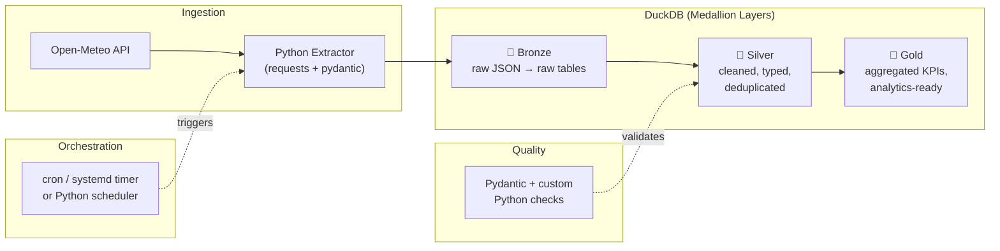
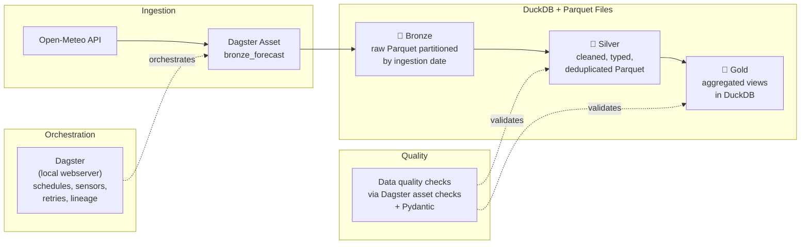
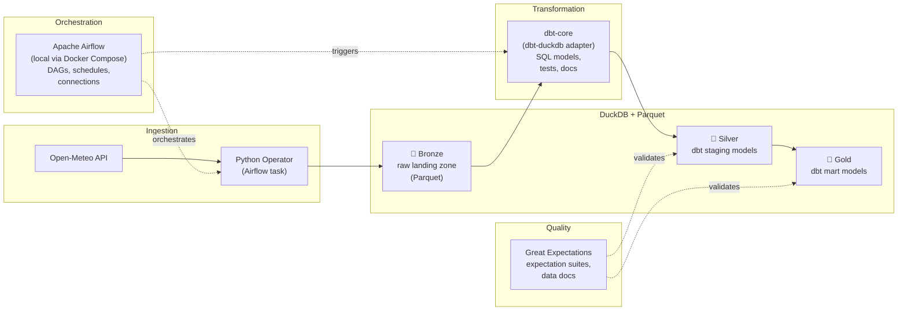
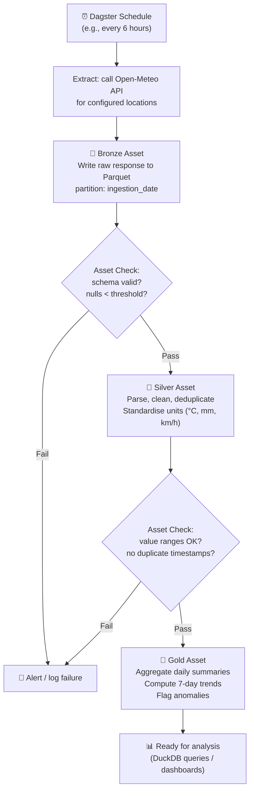

# Weather Forecast Data Pipeline — Design Proposal

## 1. Project Context

| Item | Detail |
|---|---|
| **Goal** | End-to-end weather forecast data pipeline using a public API |
| **Architecture pattern** | Medallion (Bronze → Silver → Gold) |
| **Runtime** | Fully local (no cloud services) |
| **Starting point** | Greenfield — empty workspace, Python 3.10 available |

---

## 2. Weather API Selection

| API | Auth Required | Free Tier | Historical Data | Forecast Range | Recommendation |
|---|---|---|---|---|---|
| **Open-Meteo** | ❌ No key needed | 10,000 calls/day | Back to 1940 (ERA5) | Up to 16 days | ⭐ **Recommended** |
| Visual Crossing | ✅ API key | 1,000 calls/day | Yes | 15 days | Good alternative |
| NOAA / NWS | ❌ No key | Unlimited (US only) | Limited | 7 days | US-only limitation |
| Meteostat | ❌ No key | Unlimited | Excellent station data | No forecast | Historical only |

> [!TIP]
> **Open-Meteo** is the strongest fit: no API key, generous free tier, clean JSON, and covers both forecast and historical data. All proposals below assume Open-Meteo.

---

## 3. Architecture Proposals

I've prepared **three options** ranging from lightweight to full-featured. Each follows the Medallion pattern but differs in orchestration, storage, and tooling complexity.

---

### Option A — Lightweight Python + DuckDB



#### Stack
| Concern | Tool |
|---|---|
| Language | Python 3.10 |
| HTTP client | `requests` (already installed) or `httpx` |
| Validation | `pydantic` |
| Storage & query | **DuckDB** (embedded, zero-config) |
| Orchestration | `schedule` library / cron / systemd timer |
| Data quality | Custom Python checks + Pydantic models |
| Testing | `pytest` |

#### Pros
- ✅ **Minimal dependencies** — `pip install` and go; no Docker, no JVM, no server processes
- ✅ **Fastest to build** — estimated 2–3 days to MVP
- ✅ **DuckDB is blazing fast** for analytical queries on local data, supports Parquet natively
- ✅ **Single-file database** — easy to back up, version, share
- ✅ **Low resource footprint** — runs on any machine

#### Cons
- ❌ No visual DAG / task monitoring UI (you rely on logs)
- ❌ cron-based scheduling has no built-in retry, alerting, or dependency management
- ❌ Less resume-building appeal vs. industry-standard orchestrators
- ❌ DuckDB is single-process; concurrent writers are limited

#### Best for
> Quick personal projects, learning Medallion architecture, or when you want the *thinnest possible stack*.

---

### Option B — Python + DuckDB + Dagster (Recommended)



#### Stack
| Concern | Tool |
|---|---|
| Language | Python 3.10 |
| HTTP client | `httpx` (async-capable) |
| Validation | `pydantic` |
| Storage | **DuckDB** + **Parquet** files (partitioned) |
| Orchestration | **Dagster** (local dev server with web UI) |
| Data quality | Dagster asset checks + Pydantic schemas |
| Testing | `pytest` + Dagster test utilities |
| Visualization | Dagster UI (lineage graph, run history) |

#### Pros
- ✅ **Asset-centric model** maps naturally to Medallion layers (bronze/silver/gold are Dagster assets)
- ✅ **Built-in web UI** — visual DAG, run monitoring, asset lineage, schedules
- ✅ **Retry, backfill, partitioning** out of the box
- ✅ **Data quality as first-class concept** (asset checks)
- ✅ **Runs locally** with `dagster dev` — no Docker required
- ✅ **Industry-relevant** — rapidly growing adoption in data engineering
- ✅ DuckDB + Parquet gives you fast queries and portable storage

#### Cons
- ❌ Slightly steeper learning curve than plain scripts
- ❌ Dagster dev server uses ~200–400 MB RAM
- ❌ More boilerplate in project setup (definitions, resources, assets)
- ❌ Overkill if you never plan to add more sources or complexity

#### Best for
> ⭐ **The balanced choice.** Production-like patterns without cloud overhead. Strong if you want to learn modern data engineering practices.

---

### Option C — Python + DuckDB + Airflow + dbt + Great Expectations



#### Stack
| Concern | Tool |
|---|---|
| Language | Python 3.10 + SQL |
| HTTP client | `requests` / `httpx` |
| Validation | `pydantic` + **Great Expectations** |
| Storage | **DuckDB** + **Parquet** |
| Orchestration | **Apache Airflow** (local via Docker Compose) |
| Transformation | **dbt-core** with `dbt-duckdb` adapter |
| Data quality | **Great Expectations** |
| Testing | `pytest` + dbt tests + GE suites |
| Documentation | dbt docs + GE data docs |

#### Pros
- ✅ **Industry-standard stack** — Airflow, dbt, and GE are the most widely used tools in data engineering
- ✅ **dbt excels at SQL transformations** — testing, documentation, lineage all built in
- ✅ **Great Expectations** provides rich, configurable data validation with auto-generated data docs
- ✅ **Clear separation of concerns** — extraction (Airflow), transformation (dbt), validation (GE)
- ✅ **Maximum resume value** and transferable skills

#### Cons
- ❌ **Heavy infrastructure** — Airflow alone needs Docker Compose with ~4 containers (webserver, scheduler, worker, postgres)
- ❌ **Longest setup time** — estimated 5–7 days to MVP
- ❌ **Docker required** — Airflow's local setup practically demands it
- ❌ **Operational overhead** — multiple tools to configure, version, and debug
- ❌ **Over-engineered** for a single-source weather pipeline
- ❌ GE has a steep learning curve for its configuration-driven approach

#### Best for
> Teams or portfolios where demonstrating proficiency with the "canonical" data stack matters more than simplicity.

---

## 4. Comparison Matrix

| Criteria | A: Lightweight | B: Dagster ⭐ | C: Airflow+dbt+GE |
|---|:---:|:---:|:---:|
| **Setup time** | ⚡ 1 hour | 🕐 2–3 hours | 🐢 1–2 days |
| **Time to MVP** | 2–3 days | 3–5 days | 5–7 days |
| **Dependencies** | ~5 pip packages | ~8 pip packages | Docker + ~15 packages |
| **Docker required** | ❌ No | ❌ No | ✅ Yes (Airflow) |
| **Web UI** | ❌ None | ✅ Dagster UI | ✅ Airflow + dbt docs |
| **Scheduling** | Basic (cron) | Full (schedules, sensors) | Full (Airflow DAGs) |
| **Retry / backfill** | Manual | Built-in | Built-in |
| **Data lineage** | Manual | Automatic | Partial (dbt only) |
| **Data quality** | Custom code | Asset checks | Great Expectations |
| **RAM usage** | ~50 MB | ~300 MB | ~1–2 GB |
| **Learning curve** | Low | Medium | High |
| **Industry relevance** | Low | Medium–High | High |
| **Maintainability** | ⚠️ Grows messy | ✅ Structured | ✅ Structured but complex |
| **Extensibility** | Low | High | High |

---

## 5. Recommended Architecture: Option B (Dagster + DuckDB)

> [!IMPORTANT]
> I recommend **Option B** as the best balance of simplicity, capability, and learning value. It gives you production-grade orchestration, a visual UI, and built-in data quality — all without Docker or heavy infrastructure.

### Proposed Medallion Layer Design

| Layer | Purpose | Storage Format | Key Operations |
|---|---|---|---|
| **🥉 Bronze** | Raw API responses, minimally transformed | Parquet files partitioned by `ingestion_date` | Append-only, schema-on-read, full API response preserved |
| **🥈 Silver** | Cleaned, typed, deduplicated, validated | Parquet files or DuckDB tables | Type casting, null handling, deduplication, unit standardisation, schema validation |
| **🥇 Gold** | Business-ready aggregations | DuckDB views / tables | Daily/weekly summaries, temperature trends, anomaly flags, location comparisons |

### Proposed Data Flow



---

## 6. Proposed Project Structure (Option B)

```
weather_forecast/
├── README.md
├── pyproject.toml                  # Project metadata & dependencies
├── setup.py                        # (optional) editable install
│
├── weather_forecast/               # Python package
│   ├── __init__.py
│   ├── definitions.py              # Dagster definitions entry point
│   │
│   ├── assets/                     # Dagster assets (Medallion layers)
│   │   ├── __init__.py
│   │   ├── bronze.py               # Raw API ingestion
│   │   ├── silver.py               # Cleaning & validation
│   │   └── gold.py                 # Aggregations & KPIs
│   │
│   ├── resources/                  # Dagster resources
│   │   ├── __init__.py
│   │   ├── api_client.py           # Open-Meteo API wrapper
│   │   └── duckdb_resource.py      # DuckDB connection resource
│   │
│   ├── partitions.py               # Partition definitions
│   ├── schedules.py                # Schedule definitions
│   ├── sensors.py                  # (optional) Sensor definitions
│   │
│   ├── models/                     # Pydantic schemas
│   │   ├── __init__.py
│   │   └── weather.py              # API response & domain models
│   │
│   └── utils/                      # Shared utilities
│       ├── __init__.py
│       └── config.py               # Locations, parameters, settings
│
├── data/                           # Local data lake
│   ├── bronze/                     # Raw Parquet files
│   ├── silver/                     # Cleaned Parquet files
│   └── gold/                       # Aggregated data
│
├── warehouse/                      # DuckDB database file(s)
│   └── weather.duckdb
│
├── tests/                          # Test suite
│   ├── __init__.py
│   ├── test_assets.py
│   ├── test_api_client.py
│   └── test_models.py
│
├── notebooks/                      # (optional) Exploration
│   └── exploration.ipynb
│
└── dagster.yaml                    # Dagster instance config
```

---

## 7. Key Design Decisions to Resolve

Before detailed implementation planning, please decide on:

1. **Which option?** A (lightweight), B (Dagster — recommended), or C (Airflow+dbt+GE)?
2. **Which locations to track?** (e.g., Adelaide, Sydney, Melbourne, or a configurable list?)
3. **Which weather variables?** (temperature, precipitation, wind, humidity, UV index, etc.)
4. **Ingestion frequency?** (every 6 hours, daily, hourly?)
5. **Historical backfill?** Should we load past data (e.g., last 30 days) on initial setup?
6. **Gold layer use cases?** What questions should the Gold layer answer? Examples:
   - Daily min/max/avg temperature trends
   - Precipitation probability summaries
   - Multi-city comparison dashboards
   - Weather anomaly detection

---

> [!NOTE]
> All three options share the same core Medallion architecture and Open-Meteo API integration. The differences are in **how** the layers are orchestrated, validated, and monitored. You can start with Option A and evolve to B later, but starting with B avoids rework.
