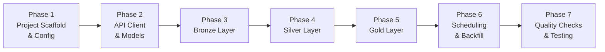
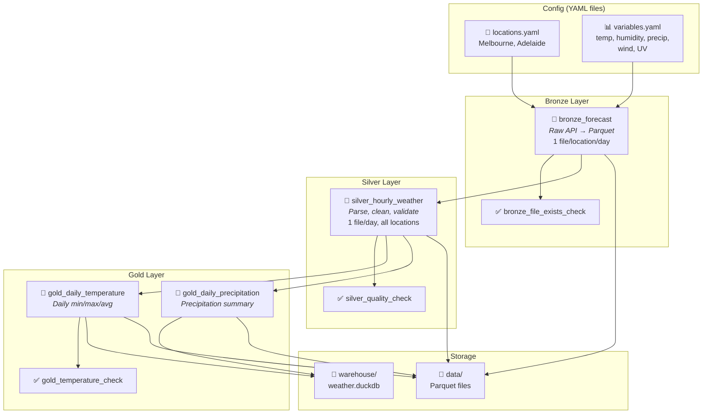

# Weather Forecast Pipeline — Detailed Implementation Plan

## Confirmed Design Decisions

| Decision | Choice |
|---|---|
| Architecture | **Option B — Dagster + DuckDB + Parquet** |
| API | **Open-Meteo** (no API key required) |
| Initial locations | Melbourne (-37.8136, 144.9631), Adelaide (-34.9285, 138.6007) |
| Weather variables | temperature_2m, relative_humidity_2m, precipitation, precipitation_probability, wind_speed_10m, wind_direction_10m, wind_gusts_10m, uv_index |
| Ingestion frequency | Hourly |
| Historical backfill | Last 30 days on initial setup |
| Gold layer | Daily min/max/avg temperature, precipitation probability summaries |

---

## Phase Overview



---

## Phase 1: Project Scaffold & Configuration

### 1.1 — Project structure creation

Create the full directory layout:

```
weather_forecast/
├── pyproject.toml
├── setup.cfg
├── dagster.yaml
├── README.md
├── .gitignore
│
├── weather_forecast/
│   ├── __init__.py
│   ├── definitions.py
│   │
│   ├── assets/
│   │   ├── __init__.py
│   │   ├── bronze.py
│   │   ├── silver.py
│   │   └── gold.py
│   │
│   ├── resources/
│   │   ├── __init__.py
│   │   ├── api_client.py
│   │   └── duckdb_resource.py
│   │
│   ├── models/
│   │   ├── __init__.py
│   │   └── weather.py
│   │
│   ├── partitions.py
│   ├── schedules.py
│   │
│   └── utils/
│       ├── __init__.py
│       └── helpers.py
│
├── config/
│   ├── locations.yaml
│   └── variables.yaml
│
├── data/
│   ├── bronze/
│   ├── silver/
│   └── gold/
│
├── warehouse/
│
└── tests/
    ├── __init__.py
    ├── conftest.py
    ├── test_api_client.py
    ├── test_models.py
    ├── test_assets_bronze.py
    ├── test_assets_silver.py
    └── test_assets_gold.py
```

### 1.2 — `pyproject.toml` — Dependencies

```toml
[project]
name = "weather_forecast"
version = "0.1.0"
description = "Weather forecast data pipeline using Medallion Architecture"
requires-python = ">=3.10"

dependencies = [
    "dagster>=1.9",
    "dagster-webserver>=1.9",
    "dagster-duckdb>=0.25",
    "duckdb>=1.1",
    "httpx>=0.27",
    "pydantic>=2.0",
    "pyarrow>=17.0",
    "pyyaml>=6.0",
]

[project.optional-dependencies]
dev = [
    "pytest>=8.0",
    "pytest-cov>=5.0",
    "ruff>=0.7",
]

[tool.dagster]
module_name = "weather_forecast.definitions"

[tool.ruff]
line-length = 100
```

### 1.3 — Configuration files (YAML)

**`config/locations.yaml`** — Configurable locations list:

```yaml
# Add/remove locations here. Each entry needs:
#   name:      Human-readable city name
#   latitude:  WGS84 latitude (decimal degrees)
#   longitude: WGS84 longitude (decimal degrees)
#   timezone:  IANA timezone string

locations:
  - name: Melbourne
    latitude: -37.8136
    longitude: 144.9631
    timezone: Australia/Melbourne

  - name: Adelaide
    latitude: -34.9285
    longitude: 138.6007
    timezone: Australia/Adelaide
```

**`config/variables.yaml`** — Configurable weather variables:

```yaml
# Open-Meteo hourly variable names.
# Full list: https://open-meteo.com/en/docs
# Add or remove variables as needed.

hourly_variables:
  - name: temperature_2m
    description: "Air temperature at 2m above ground"
    unit: "°C"

  - name: relative_humidity_2m
    description: "Relative humidity at 2m above ground"
    unit: "%"

  - name: precipitation
    description: "Total precipitation (rain + showers + snow)"
    unit: "mm"

  - name: precipitation_probability
    description: "Probability of precipitation"
    unit: "%"

  - name: wind_speed_10m
    description: "Wind speed at 10m above ground"
    unit: "km/h"

  - name: wind_direction_10m
    description: "Wind direction at 10m above ground"
    unit: "°"

  - name: wind_gusts_10m
    description: "Wind gusts at 10m above ground"
    unit: "km/h"

  - name: uv_index
    description: "UV index for the hour"
    unit: "index"

# Settings for API queries
settings:
  temperature_unit: celsius       # celsius | fahrenheit
  wind_speed_unit: kmh            # kmh | ms | mph | kn
  precipitation_unit: mm          # mm | inch
  forecast_days: 7                # 1..16
  backfill_days: 30               # Days of historical data to load on first run
```

### 1.4 — `dagster.yaml` — Dagster instance config

```yaml
storage:
  sqlite:
    base_dir: .dagster_home

run_launcher:
  module: dagster.core.launcher
  class: DefaultRunLauncher

telemetry:
  enabled: false
```

### 1.5 — `.gitignore`

```
__pycache__/
*.pyc
.dagster_home/
data/
warehouse/
*.egg-info/
.venv/
.ruff_cache/
```

> [!NOTE]
> **Output:** Runnable project skeleton. `dagster dev` launches successfully with an empty asset graph.

---

## Phase 2: API Client & Pydantic Models

### 2.1 — Pydantic models (`weather_forecast/models/weather.py`)

Define strict schemas for API responses and internal domain data:

```python
# Key models to implement:

class LocationConfig:
    """Parsed from locations.yaml"""
    name: str
    latitude: float
    longitude: float
    timezone: str

class VariablesConfig:
    """Parsed from variables.yaml"""
    hourly_variables: list[VariableDefinition]
    settings: APISettings

class HourlyWeatherRecord:
    """Single hourly observation — used in Silver layer"""
    location_name: str
    latitude: float
    longitude: float
    timestamp: datetime          # UTC
    local_timestamp: datetime    # Local timezone
    temperature_2m: float | None
    relative_humidity_2m: float | None
    precipitation: float | None
    precipitation_probability: float | None
    wind_speed_10m: float | None
    wind_direction_10m: float | None
    wind_gusts_10m: float | None
    uv_index: float | None
    ingestion_timestamp: datetime  # When this record was ingested
```

> [!IMPORTANT]
> All models use `pydantic.BaseModel` with strict validation. `None` is allowed for optional weather fields (API may return null for some variables/hours).

### 2.2 — API Client resource (`weather_forecast/resources/api_client.py`)

Implement as a **Dagster `ConfigurableResource`**:

```python
class OpenMeteoClient(ConfigurableResource):
    """Dagster resource wrapping Open-Meteo API calls."""
    
    base_url: str = "https://api.open-meteo.com/v1/forecast"
    archive_url: str = "https://archive-api.open-meteo.com/v1/archive"
    
    def fetch_forecast(self, location, variables, forecast_days) -> dict:
        """Fetch forecast data for a single location."""
        # GET request with params: latitude, longitude, hourly=var1,var2,...
        # timezone=auto, forecast_days=N
        # Returns raw JSON dict
        
    def fetch_historical(self, location, variables, start_date, end_date) -> dict:
        """Fetch historical data from the archive API."""
        # Uses archive endpoint with start_date & end_date params
        # Returns raw JSON dict
```

**Key design decisions:**
- One API call per location (Open-Meteo supports single lat/lon per request)
- Use `httpx` with timeout=30s and 3 retries with exponential backoff
- Return raw `dict` — parsing happens in the Bronze→Silver transformation
- Forecast endpoint: `api.open-meteo.com/v1/forecast`
- Historical endpoint: `archive-api.open-meteo.com/v1/archive`

> [!NOTE]
> **Output:** Working API client. Can be tested independently with `pytest` (mock HTTP responses).

---

## Phase 3: Bronze Layer

### 3.1 — Partition strategy

```python
# weather_forecast/partitions.py

daily_partitions = DailyPartitionsDefinition(
    start_date="2026-09-24",   # 30 days before project start
    timezone="UTC",
)
```

- **Partitioned by date (UTC):** each partition = one day's worth of hourly data
- Initial backfill materialises partitions from 30 days ago to today
- Ongoing runs materialise today's partition (refreshed hourly with latest forecast)

### 3.2 — Bronze asset (`weather_forecast/assets/bronze.py`)

```python
@asset(
    partitions_def=daily_partitions,
    group_name="bronze",
    compute_kind="python",
    description="Raw weather data from Open-Meteo API, stored as Parquet",
)
def bronze_forecast(
    context: AssetExecutionContext,
    open_meteo_client: OpenMeteoClient,
) -> None:
    partition_date = context.partition_key        # "2026-10-24"
    locations = load_locations_config()
    variables = load_variables_config()
    
    for location in locations:
        # Determine which endpoint to use:
        #   - If partition_date is in the past → archive API
        #   - If partition_date is today/future → forecast API
        raw_response = client.fetch(...)
        
        # Write raw JSON response as-is to Parquet
        # Path: data/bronze/{location_name}/{partition_date}.parquet
        # Columns: raw_json (string), location_name, ingestion_timestamp, partition_date
```

**Bronze storage format:**

| Column | Type | Description |
|---|---|---|
| `raw_json` | `string` | Full API response body as JSON string |
| `location_name` | `string` | e.g., "Melbourne" |
| `latitude` | `float64` | Requested latitude |
| `longitude` | `float64` | Requested longitude |
| `partition_date` | `string` | "YYYY-MM-DD" |
| `ingestion_timestamp` | `timestamp[us]` | When the data was fetched |
| `api_endpoint` | `string` | "forecast" or "archive" |

**File layout:**
```
data/bronze/
├── Melbourne/
│   ├── 2026-09-24.parquet
│   ├── 2026-09-25.parquet
│   └── ...
└── Adelaide/
    ├── 2026-09-24.parquet
    └── ...
```

> [!TIP]
> Storing the full raw JSON in Bronze preserves the complete API response. If Open-Meteo adds new fields or changes schema, we never lose data. The Silver layer handles parsing.

---

## Phase 4: Silver Layer

### 4.1 — Silver asset (`weather_forecast/assets/silver.py`)

```python
@asset(
    partitions_def=daily_partitions,
    group_name="silver",
    compute_kind="python",
    deps=[bronze_forecast],
    description="Cleaned, typed, and validated hourly weather records",
)
def silver_hourly_weather(
    context: AssetExecutionContext,
) -> None:
    partition_date = context.partition_key
    locations = load_locations_config()
    
    all_records = []
    for location in locations:
        # 1. Read Bronze Parquet for this location + partition
        # 2. Parse raw_json → extract hourly arrays
        # 3. Explode into individual hourly records
        # 4. Validate each record with Pydantic HourlyWeatherRecord
        # 5. Handle nulls, type casting, deduplication
        # 6. Standardise units (already metric from API, but enforce)
        
    # Write cleaned records to Silver Parquet
    # Path: data/silver/{partition_date}.parquet
    # One file per partition date, all locations merged
```

**Silver schema (Parquet columns):**

| Column | Type | Description |
|---|---|---|
| `location_name` | `string` | City name |
| `latitude` | `float64` | Actual lat returned by API |
| `longitude` | `float64` | Actual lon returned by API |
| `timestamp_utc` | `timestamp[us, tz=UTC]` | Observation hour (UTC) |
| `timestamp_local` | `timestamp[us]` | Observation hour (local tz) |
| `temperature_2m` | `float64` | °C |
| `relative_humidity_2m` | `float64` | % |
| `precipitation` | `float64` | mm |
| `precipitation_probability` | `float64` | % |
| `wind_speed_10m` | `float64` | km/h |
| `wind_direction_10m` | `float64` | degrees |
| `wind_gusts_10m` | `float64` | km/h |
| `uv_index` | `float64` | index value |
| `partition_date` | `string` | "YYYY-MM-DD" |
| `ingestion_timestamp` | `timestamp[us, tz=UTC]` | When ingested |

### 4.2 — Silver transformations detail

| Step | Operation | Detail |
|---|---|---|
| 1 | **Parse JSON** | Extract `hourly.time[]` and each variable array from raw response |
| 2 | **Explode** | Zip timestamp array with each variable array → one row per hour |
| 3 | **Type cast** | Ensure all numeric columns are `float64`, timestamps parsed correctly |
| 4 | **Null handling** | Keep nulls as-is (valid — e.g., UV index is null at night). Log null counts as metadata |
| 5 | **Deduplication** | Deduplicate on `(location_name, timestamp_utc)` — keep latest ingestion |
| 6 | **Timezone** | Parse ISO timestamps, store both UTC and local timezone versions |
| 7 | **Validate** | Pass each row through Pydantic model. Log/skip invalid rows |

**File layout:**
```
data/silver/
├── 2026-09-24.parquet
├── 2026-09-25.parquet
└── ...
```

> [!NOTE]
> **Output:** Clean, analysis-ready hourly records. One Parquet file per date, containing all locations. Queryable via DuckDB with `SELECT * FROM read_parquet('data/silver/*.parquet')`.

---

## Phase 5: Gold Layer

### 5.1 — DuckDB resource (`weather_forecast/resources/duckdb_resource.py`)

```python
class DuckDBResource(ConfigurableResource):
    """Manages a local DuckDB database for Gold layer analytics."""
    database_path: str = "warehouse/weather.duckdb"
    
    def get_connection(self) -> duckdb.DuckDBPyConnection:
        return duckdb.connect(self.database_path)
    
    def query(self, sql: str) -> pd.DataFrame:
        with self.get_connection() as conn:
            return conn.execute(sql).fetchdf()
```

### 5.2 — Gold asset: Daily temperature summary

```python
@asset(
    partitions_def=daily_partitions,
    group_name="gold",
    compute_kind="duckdb",
    deps=[silver_hourly_weather],
    description="Daily min/max/avg temperature by location",
)
def gold_daily_temperature(
    context: AssetExecutionContext,
    duckdb_resource: DuckDBResource,
) -> None:
    partition_date = context.partition_key
    
    # SQL logic:
    # SELECT
    #     location_name,
    #     partition_date,
    #     MIN(temperature_2m) AS temp_min,
    #     MAX(temperature_2m) AS temp_max,
    #     AVG(temperature_2m) AS temp_avg,
    #     MIN(temperature_2m) FILTER (WHERE HOUR(timestamp_local) BETWEEN 6 AND 18) AS daytime_temp_min,
    #     MAX(temperature_2m) FILTER (WHERE HOUR(timestamp_local) BETWEEN 6 AND 18) AS daytime_temp_max,
    #     AVG(relative_humidity_2m) AS humidity_avg,
    #     MAX(wind_speed_10m) AS wind_max,
    #     MAX(uv_index) AS uv_max
    # FROM read_parquet('data/silver/{partition_date}.parquet')
    # GROUP BY location_name, partition_date
    
    # Upsert result into DuckDB table: gold_daily_temperature
    # Also export to data/gold/daily_temperature/{partition_date}.parquet
```

**Gold daily temperature schema:**

| Column | Type | Description |
|---|---|---|
| `location_name` | `string` | City |
| `date` | `date` | The day |
| `temp_min_c` | `float64` | Min temp (24h) |
| `temp_max_c` | `float64` | Max temp (24h) |
| `temp_avg_c` | `float64` | Mean temp (24h) |
| `daytime_temp_min_c` | `float64` | Min temp (6am–6pm local) |
| `daytime_temp_max_c` | `float64` | Max temp (6am–6pm local) |
| `humidity_avg_pct` | `float64` | Mean humidity |
| `wind_max_kmh` | `float64` | Max wind speed |
| `uv_max` | `float64` | Max UV index |

### 5.3 — Gold asset: Precipitation probability summary

```python
@asset(
    partitions_def=daily_partitions,
    group_name="gold",
    compute_kind="duckdb",
    deps=[silver_hourly_weather],
    description="Daily precipitation summary by location",
)
def gold_daily_precipitation(
    context: AssetExecutionContext,
    duckdb_resource: DuckDBResource,
) -> None:
    # SQL logic:
    # SELECT
    #     location_name,
    #     partition_date AS date,
    #     SUM(precipitation) AS total_precipitation_mm,
    #     MAX(precipitation_probability) AS max_precip_probability_pct,
    #     AVG(precipitation_probability) AS avg_precip_probability_pct,
    #     COUNT(*) FILTER (WHERE precipitation > 0) AS rainy_hours,
    #     COUNT(*) AS total_hours,
    #     ROUND(COUNT(*) FILTER (WHERE precipitation > 0) * 100.0 / COUNT(*), 1)
    #         AS pct_hours_with_rain
    # FROM read_parquet('data/silver/{partition_date}.parquet')
    # GROUP BY location_name, partition_date
```

**Gold precipitation schema:**

| Column | Type | Description |
|---|---|---|
| `location_name` | `string` | City |
| `date` | `date` | The day |
| `total_precipitation_mm` | `float64` | Total daily precip |
| `max_precip_probability_pct` | `float64` | Peak probability |
| `avg_precip_probability_pct` | `float64` | Mean probability |
| `rainy_hours` | `int32` | Hours with precip > 0 |
| `total_hours` | `int32` | Total observed hours |
| `pct_hours_with_rain` | `float64` | % of hours with rain |

### 5.4 — Gold layer file layout

```
data/gold/
├── daily_temperature/
│   ├── 2026-09-24.parquet
│   └── ...
└── daily_precipitation/
    ├── 2026-09-24.parquet
    └── ...

warehouse/
└── weather.duckdb          # Contains gold tables for ad-hoc queries
    ├── gold_daily_temperature     (table)
    └── gold_daily_precipitation   (table)
```

> [!TIP]
> Gold data is **dual-written**: Parquet files for portability and DuckDB tables for fast interactive queries. The DuckDB tables are upserted (INSERT OR REPLACE on location_name + date) so re-runs are idempotent.

---

## Phase 6: Scheduling & Historical Backfill

### 6.1 — Hourly schedule (`weather_forecast/schedules.py`)

```python
# Define a job that covers the full asset chain
weather_pipeline_job = define_asset_job(
    name="weather_pipeline_job",
    selection=AssetSelection.groups("bronze", "silver", "gold"),
    partitions_def=daily_partitions,
)

# Hourly schedule — materialises TODAY's partition every hour
hourly_weather_schedule = ScheduleDefinition(
    job=weather_pipeline_job,
    cron_schedule="0 * * * *",       # Every hour, at :00
    execution_timezone="UTC",
    # Custom run_config_fn to always target today's partition
)
```

**Scheduling logic:**

| Trigger | Partition targeted | Effect |
|---|---|---|
| Hourly cron (`:00` each hour) | Today's date (UTC) | Refreshes forecast data — Bronze re-ingests latest forecast, Silver re-cleans, Gold re-aggregates |
| Manual backfill (Dagster UI) | Any past date range | Loads historical data from archive API |

### 6.2 — Historical backfill strategy

On first deployment, the user runs a backfill from the Dagster UI:

1. Open Dagster UI → Assets → `bronze_forecast`
2. Click **"Materialize"** → select partition range: `2026-09-24` to `2026-10-23` (30 days)
3. Dagster queues 30 partition runs sequentially
4. Each partition triggers Bronze → Silver → Gold for that date

**Backfill implementation details:**

- The Bronze asset checks: if `partition_date < today` → call **archive API** endpoint
- If `partition_date >= today` → call **forecast API** endpoint
- Rate limiting: Open-Meteo allows 600 calls/min. With 2 locations × 30 days = 60 calls total. Well within limits, no throttling needed.

> [!IMPORTANT]
> The archive API does **not** return `precipitation_probability` (only available for forecasts). The Silver layer handles this gracefully — the column is `null` for historical rows.

---

## Phase 7: Data Quality Checks & Testing

### 7.1 — Dagster asset checks

```python
@asset_check(
    asset=bronze_forecast,
    description="Verify Bronze files exist and are non-empty",
)
def bronze_file_exists_check(context) -> AssetCheckResult:
    # Check that Parquet files were written for all configured locations
    # Check file size > 0
    # Return pass/fail with metadata

@asset_check(
    asset=silver_hourly_weather,
    description="Validate Silver data quality",
)
def silver_quality_check(context) -> AssetCheckResult:
    # 1. Row count: should be ~24 rows per location per day
    # 2. Null rate: temperature_2m nulls should be < 5%
    # 3. Value ranges:
    #      temperature_2m:  -50 to +60 °C
    #      relative_humidity_2m: 0 to 100 %
    #      precipitation: >= 0
    #      wind_speed_10m: 0 to 300 km/h
    #      uv_index: 0 to 15
    # 4. No duplicate (location_name, timestamp_utc) pairs
    # Return pass/fail with detailed metadata

@asset_check(
    asset=gold_daily_temperature,
    description="Validate Gold temperature aggregations",
)
def gold_temperature_check(context) -> AssetCheckResult:
    # temp_min <= temp_avg <= temp_max
    # No null location_name or date
    # Row count = number of configured locations
```

### 7.2 — Test suite (`tests/`)

| Test file | What it covers | Approach |
|---|---|---|
| `test_api_client.py` | API client methods | Mock `httpx` responses with fixture JSON; test error handling, retries, timeout |
| `test_models.py` | Pydantic validation | Valid/invalid data; null handling; type coercion |
| `test_assets_bronze.py` | Bronze asset logic | Dagster `materialize()` with mocked API client; verify Parquet output |
| `test_assets_silver.py` | Silver transformations | Feed known Bronze Parquet; verify cleaning, dedup, schema conformance |
| `test_assets_gold.py` | Gold aggregations | Feed known Silver Parquet; verify min/max/avg calculations |
| `conftest.py` | Shared fixtures | Temp directories, sample API responses, location/variable configs |

### 7.3 — Testing strategy

```python
# Example: testing Bronze asset with Dagster's built-in test utilities
def test_bronze_forecast_creates_parquet(tmp_path, mock_api_response):
    """Bronze asset should write one Parquet file per location."""
    result = materialize(
        [bronze_forecast],
        resources={
            "open_meteo_client": MockOpenMeteoClient(response=mock_api_response),
        },
        partition_key="2026-10-24",
    )
    assert result.success
    assert (tmp_path / "bronze" / "Melbourne" / "2026-10-24.parquet").exists()
    assert (tmp_path / "bronze" / "Adelaide" / "2026-10-24.parquet").exists()
```

---

## Full Asset Dependency Graph



---

## Implementation Order & Estimated Effort

| # | Task | Est. Time | Dependencies |
|---|---|---|---|
| 1 | Create project scaffold, dirs, `pyproject.toml` | 30 min | — |
| 2 | Write `locations.yaml` and `variables.yaml` | 15 min | — |
| 3 | Write config loader utility (`utils/helpers.py`) | 30 min | #2 |
| 4 | Implement Pydantic models (`models/weather.py`) | 45 min | — |
| 5 | Implement `OpenMeteoClient` resource | 45 min | #4 |
| 6 | Write `test_api_client.py` + `test_models.py` | 30 min | #4, #5 |
| 7 | Implement `DuckDBResource` | 20 min | — |
| 8 | Define partitions (`partitions.py`) | 10 min | — |
| 9 | Implement `bronze_forecast` asset | 45 min | #3, #5, #8 |
| 10 | Write `test_assets_bronze.py` | 30 min | #9 |
| 11 | Implement `silver_hourly_weather` asset | 60 min | #4, #9 |
| 12 | Write `test_assets_silver.py` | 30 min | #11 |
| 13 | Implement `gold_daily_temperature` asset | 45 min | #7, #11 |
| 14 | Implement `gold_daily_precipitation` asset | 30 min | #7, #11 |
| 15 | Write `test_assets_gold.py` | 30 min | #13, #14 |
| 16 | Implement asset checks (bronze, silver, gold) | 45 min | #9, #11, #13 |
| 17 | Define schedule + `definitions.py` wiring | 30 min | All assets |
| 18 | Write `dagster.yaml`, README, `.gitignore` | 20 min | — |
| 19 | End-to-end test: `dagster dev` + manual materialize | 30 min | All |
| 20 | Historical backfill (30 days) via Dagster UI | 15 min | #19 |

**Total estimated effort: ~9–10 hours**

---

## Key Technical Decisions Summary

| Decision | Choice | Rationale |
|---|---|---|
| **Parquet-first, DuckDB second** | Write all layers to Parquet; DuckDB reads Parquet for Gold queries | Avoids DuckDB single-writer contention; Parquet is portable |
| **One partition = one day** | `DailyPartitionsDefinition` | Natural grain for weather data; enables clean backfills |
| **Hourly schedule refreshes today's partition** | Cron `0 * * * *` | Forecasts update frequently; each run overwrites today's Bronze/Silver/Gold |
| **Config in YAML, not code** | `config/locations.yaml`, `config/variables.yaml` | Non-developers can add cities or variables without touching Python |
| **Archive vs Forecast endpoint auto-switch** | Bronze asset checks partition date vs today | Seamless backfill — same asset handles both historical and live data |
| **Pydantic validation in Silver** | Every record validated before write | Catches API schema changes early; logs bad records rather than failing |
| **Gold dual-write (Parquet + DuckDB)** | Parquet for portability, DuckDB for queries | Best of both worlds — files are version-controllable, DB is queryable |

---

> [!CAUTION]
> **Risks to monitor:**
> - **Open-Meteo availability:** The free tier has no SLA. If the API is down during a scheduled run, Dagster's retry logic handles it, but extended outages will leave gaps.
> - **Archive API lag:** Historical data may be 2–5 days behind present. The Bronze asset should handle `404` / empty responses for very recent "historical" dates by falling back to the forecast endpoint.
> - **`precipitation_probability` not in archive:** This field is forecast-only. Silver must accept nulls for backfilled data.
