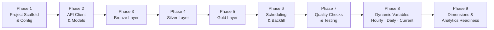
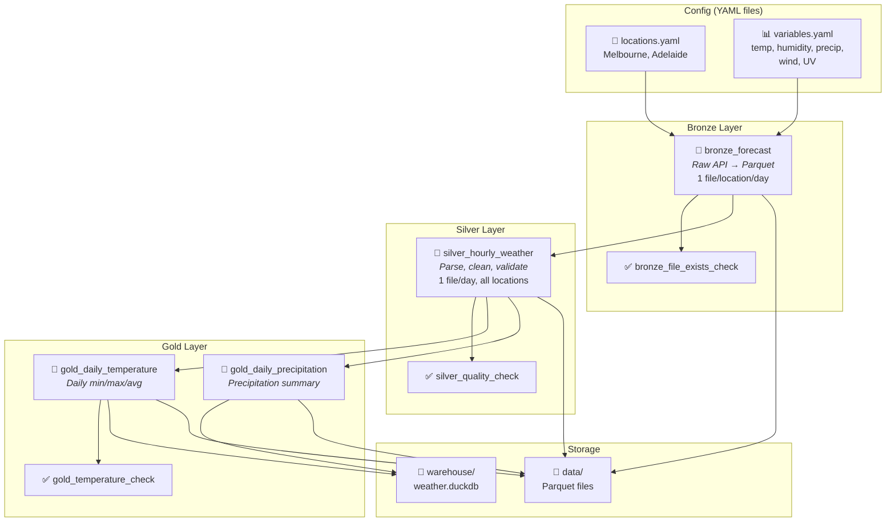

# Weather Forecast Pipeline — Detailed Implementation Plan

## Confirmed Design Decisions

| Decision | Choice |
|---|---|
| Architecture | **Option B — Dagster + DuckDB + Parquet** |
| API | **Open-Meteo** (no API key required) |
| Initial locations | Melbourne (-37.8136, 144.9631), Adelaide (-34.9285, 138.6007) |
| Weather variables | temperature_2m, relative_humidity_2m, precipitation, precipitation_probability, wind_speed_10m, wind_direction_10m, wind_gusts_10m, uv_index |
| Ingestion frequency | Hourly |
| Historical backfill | Last 30 days on initial setup |
| Gold layer | Daily min/max/avg temperature, precipitation probability summaries |

---

## Phase Overview



---

## Phase 1: Project Scaffold & Configuration

### 1.1 — Project structure creation

Create the full directory layout:

```
weather_forecast/
├── pyproject.toml
├── setup.cfg
├── dagster.yaml
├── README.md
├── .gitignore
│
├── weather_forecast/
│   ├── __init__.py
│   ├── definitions.py
│   │
│   ├── assets/
│   │   ├── __init__.py
│   │   ├── bronze.py
│   │   ├── silver.py
│   │   └── gold.py
│   │
│   ├── resources/
│   │   ├── __init__.py
│   │   ├── api_client.py
│   │   └── duckdb_resource.py
│   │
│   ├── models/
│   │   ├── __init__.py
│   │   └── weather.py
│   │
│   ├── partitions.py
│   ├── schedules.py
│   │
│   └── utils/
│       ├── __init__.py
│       └── helpers.py
│
├── config/
│   ├── locations.yaml
│   └── variables.yaml
│
├── data/
│   ├── bronze/
│   ├── silver/
│   └── gold/
│
├── warehouse/
│
└── tests/
    ├── __init__.py
    ├── conftest.py
    ├── test_api_client.py
    ├── test_models.py
    ├── test_assets_bronze.py
    ├── test_assets_silver.py
    └── test_assets_gold.py
```

### 1.2 — `pyproject.toml` — Dependencies

```toml
[project]
name = "weather_forecast"
version = "0.1.0"
description = "Weather forecast data pipeline using Medallion Architecture"
requires-python = ">=3.10"

dependencies = [
    "dagster>=1.9",
    "dagster-webserver>=1.9",
    "dagster-duckdb>=0.25",
    "duckdb>=1.1",
    "httpx>=0.27",
    "pydantic>=2.0",
    "pyarrow>=17.0",
    "pyyaml>=6.0",
]

[project.optional-dependencies]
dev = [
    "pytest>=8.0",
    "pytest-cov>=5.0",
    "ruff>=0.7",
]

[tool.dagster]
module_name = "weather_forecast.definitions"

[tool.ruff]
line-length = 100
```

### 1.3 — Configuration files (YAML)

**`config/locations.yaml`** — Configurable locations list:

```yaml
# Add/remove locations here. Each entry needs:
#   name:      Human-readable city name
#   latitude:  WGS84 latitude (decimal degrees)
#   longitude: WGS84 longitude (decimal degrees)
#   timezone:  IANA timezone string

locations:
  - name: Melbourne
    latitude: -37.8136
    longitude: 144.9631
    timezone: Australia/Melbourne

  - name: Adelaide
    latitude: -34.9285
    longitude: 138.6007
    timezone: Australia/Adelaide
```

**`config/variables.yaml`** — Configurable weather variables:

```yaml
# Open-Meteo hourly variable names.
# Full list: https://open-meteo.com/en/docs
# Add or remove variables as needed.

hourly_variables:
  - name: temperature_2m
    description: "Air temperature at 2m above ground"
    unit: "°C"

  - name: relative_humidity_2m
    description: "Relative humidity at 2m above ground"
    unit: "%"

  - name: precipitation
    description: "Total precipitation (rain + showers + snow)"
    unit: "mm"

  - name: precipitation_probability
    description: "Probability of precipitation"
    unit: "%"

  - name: wind_speed_10m
    description: "Wind speed at 10m above ground"
    unit: "km/h"

  - name: wind_direction_10m
    description: "Wind direction at 10m above ground"
    unit: "°"

  - name: wind_gusts_10m
    description: "Wind gusts at 10m above ground"
    unit: "km/h"

  - name: uv_index
    description: "UV index for the hour"
    unit: "index"

# Settings for API queries
settings:
  temperature_unit: celsius       # celsius | fahrenheit
  wind_speed_unit: kmh            # kmh | ms | mph | kn
  precipitation_unit: mm          # mm | inch
  forecast_days: 7                # 1..16
  backfill_days: 30               # Days of historical data to load on first run
```

### 1.4 — `dagster.yaml` — Dagster instance config

```yaml
storage:
  sqlite:
    base_dir: .dagster_home

run_launcher:
  module: dagster.core.launcher
  class: DefaultRunLauncher

telemetry:
  enabled: false
```

### 1.5 — `.gitignore`

```
__pycache__/
*.pyc
.dagster_home/
data/
warehouse/
*.egg-info/
.venv/
.ruff_cache/
```

> [!NOTE]
> **Output:** Runnable project skeleton. `dagster dev` launches successfully with an empty asset graph.

---

## Phase 2: API Client & Pydantic Models

### 2.1 — Pydantic models (`weather_forecast/models/weather.py`)

Define strict schemas for API responses and internal domain data:

```python
# Key models to implement:

class LocationConfig:
    """Parsed from locations.yaml"""
    name: str
    latitude: float
    longitude: float
    timezone: str

class VariablesConfig:
    """Parsed from variables.yaml"""
    hourly_variables: list[VariableDefinition]
    settings: APISettings

class HourlyWeatherRecord:
    """Single hourly observation — used in Silver layer"""
    location_name: str
    latitude: float
    longitude: float
    timestamp: datetime          # UTC
    local_timestamp: datetime    # Local timezone
    temperature_2m: float | None
    relative_humidity_2m: float | None
    precipitation: float | None
    precipitation_probability: float | None
    wind_speed_10m: float | None
    wind_direction_10m: float | None
    wind_gusts_10m: float | None
    uv_index: float | None
    ingestion_timestamp: datetime  # When this record was ingested
```

> [!IMPORTANT]
> All models use `pydantic.BaseModel` with strict validation. `None` is allowed for optional weather fields (API may return null for some variables/hours).

### 2.2 — API Client resource (`weather_forecast/resources/api_client.py`)

Implement as a **Dagster `ConfigurableResource`**:

```python
class OpenMeteoClient(ConfigurableResource):
    """Dagster resource wrapping Open-Meteo API calls."""
    
    base_url: str = "https://api.open-meteo.com/v1/forecast"
    archive_url: str = "https://archive-api.open-meteo.com/v1/archive"
    
    def fetch_forecast(self, location, variables, forecast_days) -> dict:
        """Fetch forecast data for a single location."""
        # GET request with params: latitude, longitude, hourly=var1,var2,...
        # timezone=auto, forecast_days=N
        # Returns raw JSON dict
        
    def fetch_historical(self, location, variables, start_date, end_date) -> dict:
        """Fetch historical data from the archive API."""
        # Uses archive endpoint with start_date & end_date params
        # Returns raw JSON dict
```

**Key design decisions:**
- One API call per location (Open-Meteo supports single lat/lon per request)
- Use `httpx` with timeout=30s and 3 retries with exponential backoff
- Return raw `dict` — parsing happens in the Bronze→Silver transformation
- Forecast endpoint: `api.open-meteo.com/v1/forecast`
- Historical endpoint: `archive-api.open-meteo.com/v1/archive`

> [!NOTE]
> **Output:** Working API client. Can be tested independently with `pytest` (mock HTTP responses).

---

## Phase 3: Bronze Layer

### 3.1 — Partition strategy

```python
# weather_forecast/partitions.py

daily_partitions = DailyPartitionsDefinition(
    start_date="2026-09-24",   # 30 days before project start
    timezone="UTC",
)
```

- **Partitioned by date (UTC):** each partition = one day's worth of hourly data
- Initial backfill materialises partitions from 30 days ago to today
- Ongoing runs materialise today's partition (refreshed hourly with latest forecast)

### 3.2 — Bronze asset (`weather_forecast/assets/bronze.py`)

```python
@asset(
    partitions_def=daily_partitions,
    group_name="bronze",
    compute_kind="python",
    description="Raw weather data from Open-Meteo API, stored as Parquet",
)
def bronze_forecast(
    context: AssetExecutionContext,
    open_meteo_client: OpenMeteoClient,
) -> None:
    partition_date = context.partition_key        # "2026-10-24"
    locations = load_locations_config()
    variables = load_variables_config()
    
    for location in locations:
        # Determine which endpoint to use:
        #   - If partition_date is in the past → archive API
        #   - If partition_date is today/future → forecast API
        raw_response = client.fetch(...)
        
        # Write raw JSON response as-is to Parquet
        # Path: data/bronze/{location_name}/{partition_date}.parquet
        # Columns: raw_json (string), location_name, ingestion_timestamp, partition_date
```

**Bronze storage format:**

| Column | Type | Description |
|---|---|---|
| `raw_json` | `string` | Full API response body as JSON string |
| `location_name` | `string` | e.g., "Melbourne" |
| `latitude` | `float64` | Requested latitude |
| `longitude` | `float64` | Requested longitude |
| `partition_date` | `string` | "YYYY-MM-DD" |
| `ingestion_timestamp` | `timestamp[us]` | When the data was fetched |
| `api_endpoint` | `string` | "forecast" or "archive" |

**File layout:**
```
data/bronze/
├── Melbourne/
│   ├── 2026-09-24.parquet
│   ├── 2026-09-25.parquet
│   └── ...
└── Adelaide/
    ├── 2026-09-24.parquet
    └── ...
```

> [!TIP]
> Storing the full raw JSON in Bronze preserves the complete API response. If Open-Meteo adds new fields or changes schema, we never lose data. The Silver layer handles parsing.

---

## Phase 4: Silver Layer

### 4.1 — Silver asset (`weather_forecast/assets/silver.py`)

```python
@asset(
    partitions_def=daily_partitions,
    group_name="silver",
    compute_kind="python",
    deps=[bronze_forecast],
    description="Cleaned, typed, and validated hourly weather records",
)
def silver_hourly_weather(
    context: AssetExecutionContext,
) -> None:
    partition_date = context.partition_key
    locations = load_locations_config()
    
    all_records = []
    for location in locations:
        # 1. Read Bronze Parquet for this location + partition
        # 2. Parse raw_json → extract hourly arrays
        # 3. Explode into individual hourly records
        # 4. Validate each record with Pydantic HourlyWeatherRecord
        # 5. Handle nulls, type casting, deduplication
        # 6. Standardise units (already metric from API, but enforce)
        
    # Write cleaned records to Silver Parquet
    # Path: data/silver/{partition_date}.parquet
    # One file per partition date, all locations merged
```

**Silver schema (Parquet columns):**

| Column | Type | Description |
|---|---|---|
| `location_name` | `string` | City name |
| `latitude` | `float64` | Actual lat returned by API |
| `longitude` | `float64` | Actual lon returned by API |
| `timestamp_utc` | `timestamp[us, tz=UTC]` | Observation hour (UTC) |
| `timestamp_local` | `timestamp[us]` | Observation hour (local tz) |
| `temperature_2m` | `float64` | °C |
| `relative_humidity_2m` | `float64` | % |
| `precipitation` | `float64` | mm |
| `precipitation_probability` | `float64` | % |
| `wind_speed_10m` | `float64` | km/h |
| `wind_direction_10m` | `float64` | degrees |
| `wind_gusts_10m` | `float64` | km/h |
| `uv_index` | `float64` | index value |
| `partition_date` | `string` | "YYYY-MM-DD" |
| `ingestion_timestamp` | `timestamp[us, tz=UTC]` | When ingested |

### 4.2 — Silver transformations detail

| Step | Operation | Detail |
|---|---|---|
| 1 | **Parse JSON** | Extract `hourly.time[]` and each variable array from raw response |
| 2 | **Explode** | Zip timestamp array with each variable array → one row per hour |
| 3 | **Type cast** | Ensure all numeric columns are `float64`, timestamps parsed correctly |
| 4 | **Null handling** | Keep nulls as-is (valid — e.g., UV index is null at night). Log null counts as metadata |
| 5 | **Deduplication** | Deduplicate on `(location_name, timestamp_utc)` — keep latest ingestion |
| 6 | **Timezone** | Parse ISO timestamps, store both UTC and local timezone versions |
| 7 | **Validate** | Pass each row through Pydantic model. Log/skip invalid rows |

**File layout:**
```
data/silver/
├── 2026-09-24.parquet
├── 2026-09-25.parquet
└── ...
```

> [!NOTE]
> **Output:** Clean, analysis-ready hourly records. One Parquet file per date, containing all locations. Queryable via DuckDB with `SELECT * FROM read_parquet('data/silver/*.parquet')`.

---

## Phase 5: Gold Layer

### 5.1 — DuckDB resource (`weather_forecast/resources/duckdb_resource.py`)

```python
class DuckDBResource(ConfigurableResource):
    """Manages a local DuckDB database for Gold layer analytics."""
    database_path: str = "warehouse/weather.duckdb"
    
    def get_connection(self) -> duckdb.DuckDBPyConnection:
        return duckdb.connect(self.database_path)
    
    def query(self, sql: str) -> pd.DataFrame:
        with self.get_connection() as conn:
            return conn.execute(sql).fetchdf()
```

### 5.2 — Gold asset: Daily temperature summary

```python
@asset(
    partitions_def=daily_partitions,
    group_name="gold",
    compute_kind="duckdb",
    deps=[silver_hourly_weather],
    description="Daily min/max/avg temperature by location",
)
def gold_daily_temperature(
    context: AssetExecutionContext,
    duckdb_resource: DuckDBResource,
) -> None:
    partition_date = context.partition_key
    
    # SQL logic:
    # SELECT
    #     location_name,
    #     partition_date,
    #     MIN(temperature_2m) AS temp_min,
    #     MAX(temperature_2m) AS temp_max,
    #     AVG(temperature_2m) AS temp_avg,
    #     MIN(temperature_2m) FILTER (WHERE HOUR(timestamp_local) BETWEEN 6 AND 18) AS daytime_temp_min,
    #     MAX(temperature_2m) FILTER (WHERE HOUR(timestamp_local) BETWEEN 6 AND 18) AS daytime_temp_max,
    #     AVG(relative_humidity_2m) AS humidity_avg,
    #     MAX(wind_speed_10m) AS wind_max,
    #     MAX(uv_index) AS uv_max
    # FROM read_parquet('data/silver/{partition_date}.parquet')
    # GROUP BY location_name, partition_date
    
    # Upsert result into DuckDB table: gold_daily_temperature
    # Also export to data/gold/daily_temperature/{partition_date}.parquet
```

**Gold daily temperature schema:**

| Column | Type | Description |
|---|---|---|
| `location_name` | `string` | City |
| `date` | `date` | The day |
| `temp_min_c` | `float64` | Min temp (24h) |
| `temp_max_c` | `float64` | Max temp (24h) |
| `temp_avg_c` | `float64` | Mean temp (24h) |
| `daytime_temp_min_c` | `float64` | Min temp (6am–6pm local) |
| `daytime_temp_max_c` | `float64` | Max temp (6am–6pm local) |
| `humidity_avg_pct` | `float64` | Mean humidity |
| `wind_max_kmh` | `float64` | Max wind speed |
| `uv_max` | `float64` | Max UV index |

### 5.3 — Gold asset: Precipitation probability summary

```python
@asset(
    partitions_def=daily_partitions,
    group_name="gold",
    compute_kind="duckdb",
    deps=[silver_hourly_weather],
    description="Daily precipitation summary by location",
)
def gold_daily_precipitation(
    context: AssetExecutionContext,
    duckdb_resource: DuckDBResource,
) -> None:
    # SQL logic:
    # SELECT
    #     location_name,
    #     partition_date AS date,
    #     SUM(precipitation) AS total_precipitation_mm,
    #     MAX(precipitation_probability) AS max_precip_probability_pct,
    #     AVG(precipitation_probability) AS avg_precip_probability_pct,
    #     COUNT(*) FILTER (WHERE precipitation > 0) AS rainy_hours,
    #     COUNT(*) AS total_hours,
    #     ROUND(COUNT(*) FILTER (WHERE precipitation > 0) * 100.0 / COUNT(*), 1)
    #         AS pct_hours_with_rain
    # FROM read_parquet('data/silver/{partition_date}.parquet')
    # GROUP BY location_name, partition_date
```

**Gold precipitation schema:**

| Column | Type | Description |
|---|---|---|
| `location_name` | `string` | City |
| `date` | `date` | The day |
| `total_precipitation_mm` | `float64` | Total daily precip |
| `max_precip_probability_pct` | `float64` | Peak probability |
| `avg_precip_probability_pct` | `float64` | Mean probability |
| `rainy_hours` | `int32` | Hours with precip > 0 |
| `total_hours` | `int32` | Total observed hours |
| `pct_hours_with_rain` | `float64` | % of hours with rain |

### 5.4 — Gold layer file layout

```
data/gold/
├── daily_temperature/
│   ├── 2026-09-24.parquet
│   └── ...
└── daily_precipitation/
    ├── 2026-09-24.parquet
    └── ...

warehouse/
└── weather.duckdb          # Contains gold tables for ad-hoc queries
    ├── gold_daily_temperature     (table)
    └── gold_daily_precipitation   (table)
```

> [!TIP]
> Gold data is **dual-written**: Parquet files for portability and DuckDB tables for fast interactive queries. The DuckDB tables are upserted (INSERT OR REPLACE on location_name + date) so re-runs are idempotent.

---

## Phase 6: Scheduling & Historical Backfill

### 6.1 — Hourly schedule (`weather_forecast/schedules.py`)

```python
# Define a job that covers the full asset chain
weather_pipeline_job = define_asset_job(
    name="weather_pipeline_job",
    selection=AssetSelection.groups("bronze", "silver", "gold"),
    partitions_def=daily_partitions,
)

# Hourly schedule — materialises TODAY's partition every hour
hourly_weather_schedule = ScheduleDefinition(
    job=weather_pipeline_job,
    cron_schedule="0 * * * *",       # Every hour, at :00
    execution_timezone="UTC",
    # Custom run_config_fn to always target today's partition
)
```

**Scheduling logic:**

| Trigger | Partition targeted | Effect |
|---|---|---|
| Hourly cron (`:00` each hour) | Today's date (UTC) | Refreshes forecast data — Bronze re-ingests latest forecast, Silver re-cleans, Gold re-aggregates |
| Manual backfill (Dagster UI) | Any past date range | Loads historical data from archive API |

### 6.2 — Historical backfill strategy

On first deployment, the user runs a backfill from the Dagster UI:

1. Open Dagster UI → Assets → `bronze_forecast`
2. Click **"Materialize"** → select partition range: `2026-09-24` to `2026-10-23` (30 days)
3. Dagster queues 30 partition runs sequentially
4. Each partition triggers Bronze → Silver → Gold for that date

**Backfill implementation details:**

- The Bronze asset checks: if `partition_date < today` → call **archive API** endpoint
- If `partition_date >= today` → call **forecast API** endpoint
- Rate limiting: Open-Meteo allows 600 calls/min. With 2 locations × 30 days = 60 calls total. Well within limits, no throttling needed.

> [!IMPORTANT]
> The archive API does **not** return `precipitation_probability` (only available for forecasts). The Silver layer handles this gracefully — the column is `null` for historical rows.

---

## Phase 7: Data Quality Checks & Testing

### 7.1 — Dagster asset checks

```python
@asset_check(
    asset=bronze_forecast,
    description="Verify Bronze files exist and are non-empty",
)
def bronze_file_exists_check(context) -> AssetCheckResult:
    # Check that Parquet files were written for all configured locations
    # Check file size > 0
    # Return pass/fail with metadata

@asset_check(
    asset=silver_hourly_weather,
    description="Validate Silver data quality",
)
def silver_quality_check(context) -> AssetCheckResult:
    # 1. Row count: should be ~24 rows per location per day
    # 2. Null rate: temperature_2m nulls should be < 5%
    # 3. Value ranges:
    #      temperature_2m:  -50 to +60 °C
    #      relative_humidity_2m: 0 to 100 %
    #      precipitation: >= 0
    #      wind_speed_10m: 0 to 300 km/h
    #      uv_index: 0 to 15
    # 4. No duplicate (location_name, timestamp_utc) pairs
    # Return pass/fail with detailed metadata

@asset_check(
    asset=gold_daily_temperature,
    description="Validate Gold temperature aggregations",
)
def gold_temperature_check(context) -> AssetCheckResult:
    # temp_min <= temp_avg <= temp_max
    # No null location_name or date
    # Row count = number of configured locations
```

### 7.2 — Test suite (`tests/`)

| Test file | What it covers | Approach |
|---|---|---|
| `test_api_client.py` | API client methods | Mock `httpx` responses with fixture JSON; test error handling, retries, timeout |
| `test_models.py` | Pydantic validation | Valid/invalid data; null handling; type coercion |
| `test_assets_bronze.py` | Bronze asset logic | Dagster `materialize()` with mocked API client; verify Parquet output |
| `test_assets_silver.py` | Silver transformations | Feed known Bronze Parquet; verify cleaning, dedup, schema conformance |
| `test_assets_gold.py` | Gold aggregations | Feed known Silver Parquet; verify min/max/avg calculations |
| `conftest.py` | Shared fixtures | Temp directories, sample API responses, location/variable configs |

### 7.3 — Testing strategy

```python
# Example: testing Bronze asset with Dagster's built-in test utilities
def test_bronze_forecast_creates_parquet(tmp_path, mock_api_response):
    """Bronze asset should write one Parquet file per location."""
    result = materialize(
        [bronze_forecast],
        resources={
            "open_meteo_client": MockOpenMeteoClient(response=mock_api_response),
        },
        partition_key="2026-10-24",
    )
    assert result.success
    assert (tmp_path / "bronze" / "Melbourne" / "2026-10-24.parquet").exists()
    assert (tmp_path / "bronze" / "Adelaide" / "2026-10-24.parquet").exists()
```

---

## Phase 8: Dynamic Open-Meteo Variables — Hourly, Daily & Current

> [!IMPORTANT]
> **Status: implemented 2026-10-24.** Approved D1–D4; tracked in story **#15** and sub-issues #16–#21 (§8.12), one commit each. `bronze_forecast` kept its name (the rename floated in §8.6 wasn't needed).

### 8.1 — Problem

`config/variables.yaml` is meant to be dynamic ("add variables without code changes"), but the current design only partly supports this:

| Area | Current limitation |
|---|---|
| `OpenMeteoClient` (`resources/api_client.py`) | `fetch_forecast()` / `fetch_historical()` have a fixed signature: `hourly_variables` plus three hard-coded unit kwargs. Other API parameters (`models`, `cell_selection`, `past_days`, `elevation`, …) can't be passed |
| Request sections | Only `hourly` is supported. Open-Meteo's **`daily`** aggregates (e.g. `temperature_2m_max`, `sunrise`, `precipitation_sum`) and **`current`** conditions aren't modelled at all |
| Archive variable filtering | `precipitation_probability` is hard-coded as "forecast-only". Every other variable the archive lacks (e.g. `uv_index`) slips through unnoticed |
| Error handling | An invalid variable name returns HTTP 400. The client retries it 3× with backoff, then raises without Open-Meteo's `reason` |
| Silver (`assets/silver.py`, `models/weather.py`) | `WEATHER_COLUMNS`, `VALUE_RANGES` and `HourlyWeatherRecord` hard-code the 8 initial variables. **A variable added to the YAML is fetched into Bronze but silently dropped in Silver** |
| Types | Silver forces every variable to `float64`. Open-Meteo also returns time-valued variables (`sunrise`, `sunset`: `iso8601`/`unixtime` units) and codes (`weather_code`, `is_day`) |
| Gold (`assets/gold.py`) | SQL references specific columns, and output names assume metric units (`_c`, `_kmh`). Removing `temperature_2m` from the YAML, or switching to `fahrenheit`, breaks it silently or mislabels values |

### 8.2 — Verified API behaviour (probed 2026-10-24)

| Behaviour | Result | Design consequence |
|---|---|---|
| Unsupported variable on an endpoint (e.g. archive + `uv_index` / `precipitation_probability`) | HTTP 200, unit `"undefined"`, all values `null` | Detect unsupported variables from `*_units`; drop the hard-coded filter |
| Unknown variable name | HTTP 400 `{"error": true, "reason": "…"}` | Fail fast on 4xx (except 429) and surface `reason` |
| `daily` aggregation window | Follows the request `timezone` (defaults to GMT) | With today's `timezone=GMT`, "daily max" would be a **UTC-day** max (10:30–10:30 in Adelaide) → see **D1** |
| `timeformat=unixtime` + `timezone=Australia/Adelaide` | Hourly `time` = exact UTC epoch seconds; daily `time` = epoch of **local** midnight; `utc_offset_seconds` = 37800 | Gives DST-safe UTC hourly timestamps *and* local-day daily rows from one call |
| `current` on the forecast API | `{"time", "interval": 900, <vars>}`: one 15-min snapshot | Not reproducible for past dates → append-only snapshots (**D3**) |
| `current` on the archive API | Silently ignored | Never send `current` to the archive |
| Daily on the archive API | Supported (`temperature_2m_max`, `precipitation_sum`, `sunrise`, …) | Backfill works for daily too |
| Value types | `sunrise` → time string/epoch; `weather_code` → WMO code; `daylight_duration` → seconds | Silver dtype derived from units, not assumed `float64` |

### 8.3 — Configuration schema (`config/variables.yaml`)

Backward-compatible: `hourly_variables` keeps its name, and two optional sections are added (**D4 — approved**). Each variable can declare an optional `valid_range` that the Silver quality check uses, replacing the hard-coded `VALUE_RANGES`.

```yaml
hourly_variables:
  - name: temperature_2m
    description: "Air temperature at 2 meters above ground"
    unit: "°C"
    valid_range: [-60, 65]        # optional — used by silver quality checks
  - name: cloud_cover             # any Open-Meteo hourly variable, no code change
    description: "Total cloud cover"
    unit: "%"
    valid_range: [0, 100]

daily_variables:                  # NEW — Open-Meteo daily aggregates (local calendar day)
  - name: temperature_2m_max
    description: "Maximum daily air temperature"
    unit: "°C"
  - name: sunrise
    description: "Sunrise time"
    unit: "iso8601"

current_variables:                # NEW — 15-minute "current conditions" snapshot
  - name: temperature_2m
    description: "Current air temperature"
    unit: "°C"
  - name: weather_code
    description: "WMO weather code"
    unit: "wmo code"

settings:
  temperature_unit: celsius       # validated: celsius | fahrenheit
  wind_speed_unit: kmh            # validated: kmh | ms | mph | kn
  precipitation_unit: mm          # validated: mm | inch
  forecast_days: 7
  backfill_days: 30
  current_interval_minutes: 15    # NEW — current-weather poll cadence: 15 | 30 | 60 (D3b)
  extra_params: {}                # NEW — passthrough, e.g. {models: best_match, cell_selection: land}
```

Model changes (`models/weather.py`):
- `VariableDefinition.valid_range: tuple[float, float] | None`
- `VariablesConfig.daily_variables` / `current_variables` (default `[]`), with `hourly_names` / `daily_names` / `current_names` properties (`variable_names` is kept as an alias for hourly)
- `APISettings` units become `Literal[...]`; add `extra_params: dict[str, str | int | float | bool]`, rejecting keys the pipeline controls (`latitude`, `longitude`, `hourly`, `daily`, `current`, `timezone`, `timeformat`, `start_date`, `end_date`, `forecast_days`, `past_days`)
- Duplicate variable names within a section → validation error

### 8.4 — Generic `OpenMeteoClient`

Replace the two fixed-signature methods with one request model and one fetch method. The client knows nothing about specific variables.

```python
class OpenMeteoRequest(BaseModel):
    latitude: float
    longitude: float
    hourly: list[str] = []
    daily: list[str] = []
    current: list[str] = []
    timezone: str = "GMT"
    start_date: date | None = None          # mutually exclusive with forecast_days/past_days
    end_date: date | None = None
    forecast_days: int | None = None
    past_days: int | None = None
    params: dict[str, str | int | float | bool] = {}   # units + extra_params

    def to_query(self, endpoint: Literal["forecast", "archive"]) -> dict:
        # comma-join non-empty sections; always timeformat=unixtime;
        # drop `current` (and forecast_days/past_days) for archive

class OpenMeteoClient(ConfigurableResource):
    base_url: str = "https://api.open-meteo.com/v1/forecast"
    archive_url: str = "https://archive-api.open-meteo.com/v1/archive"

    def fetch(self, endpoint: Literal["forecast", "archive"], request: OpenMeteoRequest) -> dict: ...

def unsupported_variables(response: dict) -> dict[str, list[str]]:
    """{'hourly': ['uv_index'], ...} — variables whose unit is 'undefined'."""
```

Error handling:
- Retry only on timeouts, connection errors, 429 and 5xx. Any other 4xx raises immediately with `OpenMeteoAPIError(status, reason)`.
- A 200 body with `"error": true` also raises `OpenMeteoAPIError`.

### 8.5 — Timezone strategy (**D1 — approved: option B**)

| Option | Hourly | Daily | Notes |
|---|---|---|---|
| A. Keep `timezone=GMT` | UTC ✔ | Aggregated over **UTC** days ✘ | Simplest, but daily values are misleading for non-UTC cities |
| **B. Location timezone + `timeformat=unixtime` (approved)** | Exact UTC epochs ✔ (DST-safe) | Aggregated over **local** calendar days ✔ | One call per location still returns both sections |

How option B fits the existing UTC partitions:
- A UTC day `d` spans local dates `d-1..d+1` for any UTC offset. Bronze requests `start_date=d-1, end_date=d+1` in the location's timezone.
- Silver keeps hourly rows whose **UTC** date is `d`, and the daily row whose **local** date is `d`.
- For today's partition the forecast request uses `past_days=1` + `forecast_days`, so the early UTC hours of today are included.
- Silver's `utc_offset_seconds != 0` guard is replaced: hourly times are epochs, and the daily date = `time + utc_offset_seconds`.

### 8.6 — Bronze changes

| Asset | Change |
|---|---|
| `bronze_forecast` (rename to `bronze_weather`?) | One request per location with `hourly` + `daily` from config (option B window). Raw JSON stored unchanged. Output metadata adds `unsupported_variables` per location. The archive-empty fallback checks hourly *and* daily |
| **`bronze_current`** (new, **D3**) | See §8.8 |

Hourly/daily Bronze layout is unchanged: `data/bronze/{location}/{date}.parquet`.

### 8.7 — Silver: dynamic schema (**D2 — approved: option A**)

| Option | Shape | Pros | Cons |
|---|---|---|---|
| **A. Wide, columns from config (approved)** | Fixed keys + one column per configured variable | Matches existing Gold SQL; analyst-friendly | Schema changes when config changes, so reads use `read_parquet(..., union_by_name=true)` |
| B. Long / EAV | `location, timestamp, variable, value, unit` | Never changes schema | Time-valued variables don't fit a numeric `value`; every Gold query needs a pivot |

With option A:
- **Layout:** `data/silver/hourly/{date}.parquet` (moved from `data/silver/{date}.parquet`), `data/silver/daily/{date}.parquet` and `data/silver/current/{date}.parquet`.
- **Dtypes** come from the response units: `unixtime`/`iso8601` → `timestamp[UTC]`, everything else → `float64` (codes stay float so nulls are preserved).
- **Validation:** the fixed `HourlyWeatherRecord` is replaced by Pydantic models built at runtime from the config (`pydantic.create_model`), one per section. Every record is still validated.
- **Unsupported or missing variables** become all-null columns (the column always exists for configured variables). Null % and the unsupported list go into metadata.

| Asset | Keys | Notes |
|---|---|---|
| `silver_hourly_weather` | `location_name, timestamp_utc, timestamp_local` | Dynamic hourly columns |
| **`silver_daily_weather`** (new) | `location_name, date_local` | One row per location per partition; dynamic daily columns |
| **`silver_current_weather`** (new, **D3**) | `location_name, observed_at_utc` | See §8.8 |

Quality checks become config-driven:
- `silver_quality_check` checks ranges against `valid_range` per variable and keeps its row-count and duplicate checks.
- New `silver_daily_check`: one row per location.
- Current-weather checks: see §8.8.

### 8.8 — Current weather design (**D3 — approved: B + C, 15-min cadence**)

#### What Open-Meteo's `current` actually is

| Fact | Evidence (probed 2026-10-24) | Implication |
|---|---|---|
| A **model value** for the current 15-minute slot, **not a station observation** | `current` at `09:45` matched the `minutely_15` series at `09:45` exactly, for Adelaide and Berlin (temperature and wind) | It's the latest nowcast, not ground truth. The archive (reanalysis) supersedes it for history |
| Refreshes every **15 minutes** | `"interval": 900`; `time` is aligned to :00/:15/:30/:45 | Polling more often than every 15 min returns the same snapshot |
| **Forecast endpoint only**; can't be requested for a past time | The archive silently ignores `current` | A missed poll is a **permanent gap**; Dagster backfills can't recreate it |
| Real 15-min resolution in Australia (not a straight interpolation of the hourly series) | Adelaide wind 9.4 → 9.8 → 10.0 → 10.0 → 9.6 across 09:00–10:00 | Captures some intra-hour variation that hourly rows miss |

It therefore fits the batch, partitioned Medallion model poorly in two ways:
- **Re-running a partition can't reproduce it.** Dagster normally assumes that materializing a partition again gives the same result.
- **It accumulates during the day** (a series of snapshots) instead of arriving as one complete day.

#### Options

| Option | What you get | Pros | Cons |
|---|---|---|---|
| A. Don't ingest `current` | Nothing. `current_variables` stays unused/removed | Zero complexity; hourly + archive already cover history | No "conditions right now" view; config section unused |
| B. **Snapshot history** | Every polled snapshot kept: a 15-min "as-reported" time series per location | Full history of what the pipeline saw; supports nowcast-vs-forecast comparisons later | Not backfillable; gaps are permanent; many small Bronze files |
| C. **Latest conditions only** | One row per location: the most recent snapshot, overwritten each poll | Simplest consumer view for dashboards; no partition semantics to bend | No history; the previous value is lost on every poll |
| **B + C (recommended)** | B's history in Bronze/Silver, plus C as a Gold "latest" table | History and a ready-to-query "now" view; C is a cheap query over B | The most moving parts of the three (3 assets + 1 job/schedule) |

> Alternative for later, not part of D3: because `current` equals the `minutely_15` value for that slot, a **reproducible, backfillable** 15-min history could instead come from the `minutely_15` section (requested by date like hourly). Its past values reflect the newest model runs rather than what was reported at the time. This would be a separate story if wanted.

#### Approved design (B + C)

**Assets**

| Asset | Partitioned | Storage | Behaviour |
|---|---|---|---|
| `bronze_current` | Daily (UTC) | `data/bronze/current/{location}/{date}/{HHMM}.parquet` (raw JSON + metadata, like Bronze) | Calls the forecast endpoint with only `current=<current_variables>`. **The file is named after the observation time `current.time`, not the run time,** so a re-run in the same 15-min slot overwrites the same file and stays idempotent. For a partition other than today (UTC) it writes nothing, logs a warning and records `snapshots_written: 0` (this past-date guard is why the asset is safe if someone runs a backfill that includes it) |
| `silver_current_weather` | Daily (UTC) | `data/silver/current/{date}.parquet` | Rebuilds the day from **all** Bronze snapshot files, so it's idempotent. Columns: `location_name, observed_at_utc, observed_at_local, interval_seconds, <current_variables…>, ingestion_timestamp`. Dynamic columns and dtypes as in §8.7. Dedup on `(location_name, observed_at_utc)`, keeping the latest ingestion. Also **compacts** the day's small Bronze files into one Parquet |
| `gold_current_conditions` | **Not partitioned** | DuckDB table `gold_current_conditions` + `data/gold/current_conditions/latest.parquet` (both overwritten) | Latest snapshot per location from today's Silver (plus yesterday's, for the first minutes after UTC midnight), with `age_minutes` |

**Job & schedule.** Kept separate from the hourly pipeline:
- `current_weather_job` selects only the three current assets.
- `weather_pipeline_job` explicitly **excludes** them, so historical backfills never touch current weather.
- `current_weather_schedule` builds its cron from a new setting `settings.current_interval_minutes` (allowed: `15 | 30 | 60`; see **D3b**) and targets today's UTC partition.
- Current uses its own API call rather than adding `current=` to the hourly/daily call. The two run at different cadences, and the hourly asset also runs for past dates, where `current` makes no sense.

**Quality checks**
- `silver_current_check`: no duplicate `(location, observed_at_utc)`; values within `valid_range`.
- `gold_current_freshness_check`: every configured location has a snapshot no older than `2 × current_interval_minutes`. This surfaces a stopped scheduler or a failing API quickly.

**API budget** (free tier: 10,000 calls/day)

| Cadence | Calls/location/day (24 hourly-pipeline + current) | Max locations |
|---|---|---|
| 15 min | 24 + 96 = 120 | ~83 |
| 30 min | 24 + 48 = 72 | ~138 |
| 60 min | 24 + 24 = 48 | ~208 |

Config validation logs a warning when `locations × calls/day` exceeds 80% of the daily limit.

**Known limitations (documented in README/AGENTS.md)**
- Gaps are permanent: snapshots missed while Dagster is stopped can't be recovered.
- At a 15-min cadence Bronze gains 96 small files per location per day. Silver compacts them daily; Bronze retention/compaction is out of scope.
- Values are model nowcasts; for verified history use the archive-backed hourly data.

**Tests**
- `bronze_current`:
  - file named after `current.time`
  - a re-run in the same slot overwrites the file instead of adding one
  - a past partition writes nothing
- `silver_current_weather`: rebuilds from multiple snapshots; dedups; dynamic columns
- `gold_current_conditions`: picks the latest per location across the UTC midnight boundary
- Freshness check: fails when the snapshot is stale
- Schedule:
  - cron derived from `current_interval_minutes`
  - `weather_pipeline_job` excludes the current assets
  - invalid interval rejected

#### Sub-decisions

| # | Question | Options | Recommendation |
|---|---|---|---|
| **D3a** | Scope | A (skip) / B (history) / C (latest only) / **B + C** | **B + C** |
| **D3b** | Default poll cadence | **15 min** (matches API refresh, ~83-location ceiling) / 30 min / 60 min (fewest files, rides the hourly cadence) | **15 min**, configurable |

### 8.9 — Gold safeguards

Gold keeps computing from hourly Silver (no new Gold metrics in this phase).
- Each Gold asset declares `REQUIRED_HOURLY_VARIABLES`. A helper checks these against the config **when the definitions load**, so removing e.g. `temperature_2m` gives a clear error instead of broken SQL.
- Gold output names assume metric units, so the same validation rejects non-metric `settings` units, until unit-neutral Gold naming is designed (out of scope).
- Gold reads `data/silver/hourly/`.

### 8.10 — Definitions, schedule & docs

- Register `silver_daily_weather` and its check in `weather_pipeline_job` (the job selects by group, so the hourly schedule picks it up automatically).
- Current weather (subject to D3): register `bronze_current`, `silver_current_weather`, `gold_current_conditions`, their checks, `current_weather_job` and `current_weather_schedule`. Exclude the current assets from `weather_pipeline_job` (§8.8).
- **AGENTS.md / README:** replace "the Silver Pydantic model may need updating" with "no code change needed". Document the three sections, `valid_range`, `extra_params` and the timezone strategy.

### 8.11 — Tests

| File | Cases |
|---|---|
| `test_models.py` | New sections default to empty; `valid_range` parsing; unit `Literal` validation; reserved `extra_params` keys rejected; duplicate names rejected |
| `test_api_client.py` | `to_query` per endpoint (sections comma-joined, empty sections omitted, `current` dropped for archive, `timeformat=unixtime`); 400 → immediate `OpenMeteoAPIError` with `reason`, no retry; 429/5xx retried; `unsupported_variables()` |
| `test_assets_bronze.py` | Option B date window (`d-1..d+1`, `past_days=1` for today); hourly + daily in one call; `bronze_current` cases in §8.8 |
| `test_assets_silver.py` | **An extra configured variable (`cloud_cover`) appears in Silver with no code change**; time-valued daily variable typed as timestamp; unsupported variable → null column; UTC filtering across the Adelaide DST start (2026-10-04); daily row = local date; current cases in §8.8 |
| `test_assets_gold.py` | Missing required variable / non-metric units → load-time error; reads the new hourly path |

Fixtures: a temp `variables.yaml` fixture (the loaders are `lru_cache`d, so tests clear the cache) and API response builders for `daily`/`current` in `unixtime` format.

### 8.12 — Tracking & delivery (per AGENTS.md workflow)

Story **#15 `[Story] Phase 8: Dynamic Open-Meteo variables — hourly, daily & current`**, with sub-issues and one commit each:

| # | Issue | Scope | Est. |
|---|---|---|---|
| 8.1 (#16) | `[Task]` Config schema for hourly/daily/current, `valid_range`, `extra_params` | §8.3 + tests | 45 min |
| 8.2 (#17) | `[Task]` Generic `OpenMeteoClient` request model and 4xx handling | §8.4 + tests | 1 h |
| 8.3 (#18) | `[Task]` Bronze: local-timezone unixtime window, hourly + daily in one call | §8.5–8.6 + tests | 1 h |
| 8.4 (#19) | `[Task]` Silver: dynamic hourly schema + `silver_daily_weather` | §8.7 + tests | 1.5 h |
| 8.5 (#20) | `[Task]` Current weather: `bronze_current`, `silver_current_weather`, `gold_current_conditions`, job/schedule, checks | §8.8 + tests | 1.5 h |
| 8.6 (#21) | `[Task]` Gold required-variable/unit validation, wiring, docs | §8.9–8.10 + tests | 45 min |

**Total: ~6.5 hours.** Order: 8.1 → 8.2 → 8.3 → 8.4 → (8.5 ∥ 8.6).

### 8.13 — Decisions

| # | Decision | Outcome |
|---|---|---|
| **D1** | Request timezone for hourly + daily | ✅ Approved: **B**, location timezone + `timeformat=unixtime` |
| **D2** | Silver shape for dynamic variables | ✅ Approved: **A**, wide, columns from config, `union_by_name` reads |
| **D3a** | Current weather scope | ✅ Approved: **B + C**, snapshot history + latest-conditions table (§8.8) |
| **D3b** | Current poll cadence | ✅ Approved: **15 min**, configurable (`settings.current_interval_minutes`) |
| **D4** | Config keys | ✅ Approved: keep `hourly_variables`, add `daily_variables` / `current_variables` |

Out of scope (candidates for later stories): `minutely_15` data (the client design supports it, but no assets), multi-location batching (Open-Meteo accepts comma-separated coordinates), Gold metrics built from API daily aggregates, unit-neutral Gold column names.

---

## Phase 9: Dimensions & Analytics Readiness (WMO codes, locations)

> [!IMPORTANT]
> **Status: approved 2026-10-25.** D5–D9 approved as recommended; **D10 (order of Phases 10–12) on hold**. Tracked in story **#25** (sub-issues #26–#31). Bug #24 (F6) is fixed first.

### 9.1 — Requests

1. Add Open-Meteo's **WMO weather interpretation codes** to the warehouse as a **dimension table**, so `weather_code` values can be mapped to descriptions and categories.
2. Include the **location** in the data as a proper entity: a stable key plus attributes, for joins and grouping in analytics.
3. Research **common analytics on weather forecast data** and assess whether the current data supports them.

### 9.2 — What the pipeline stores today

| Data | Grain | Contents | Notes |
|---|---|---|---|
| Silver hourly | city × hour (UTC day partitions) | 8 hourly variables | **No `weather_code`**, `is_day` or `apparent_temperature` |
| Silver daily | city × local day | 8 daily aggregates (max/min temp, precip sum, sunrise/sunset, …) | **No `weather_code`** |
| Silver current | city × 15-min snapshot | 8 current variables incl. `weather_code` | `weather_code` stored as float; history only since polling began |
| Gold daily temperature / precipitation | city × **UTC** day | Aggregates of hourly rows in the UTC partition | See finding F1 |
| Gold current conditions | city | Latest snapshot | — |
| Locations | — | Only a `location_name` string, plus the API grid lat/lon repeated on each row | No stable id, elevation, timezone, region or country in the data |
| Forecast horizon | — | Today's Bronze file holds `past_days=1` + 7 forecast days | Overwritten every hour; Silver/Gold keep only the partition day (F2) |
| History | — | `backfill_days` (30, max 365) | No climatology baseline (F5) |

### 9.3 — Findings (verified on the backfilled data, 2026-10-24)

| # | Finding | Evidence / impact |
|---|---|---|
| **F1** | **Gold "daily" summaries cover UTC days, not local days.** This is *our* aggregation, not the API's. `gold_daily_*` SQL reads the Silver **hourly** file for the partition, whose rows are kept by UTC date. For Australian cities a UTC day runs 10:30–10:30 / 11:00–11:00 local, so each Gold row mixes two local days. The "daytime" columns are worse: one Adelaide row combines 11:00–18:00 of one local day with 06:00–10:00 of the next. The API's **daily** values (Silver daily) are a different thing: Bronze requests them in the location's timezone (D1), so they are local-day aggregates. No contradiction. | Re-measured against our own hourly data grouped by **true local day** (no API daily values involved), 58 complete city-days: Gold differs by ≥ 1 °C on **9** (max temp, worst 4.1 °C, Adelaide 2026-10-21) and **49** (min temp: the UTC window takes in the next local morning's low); precipitation differs by ≥ 1 mm on **16** (worst 19.6 mm). Gold equals the UTC-day aggregate on 62/62. *(The first draft's "25 of 60, worst 8.5 °C" compared against Silver daily rows mislabelled by F6.)* |
| **F2** | **Forecast vintages aren't kept.** Each hourly run overwrites today's Bronze file, and Silver/Gold only keep the partition day. | No 7-day outlook in Silver/Gold; no "what was forecast for day D, issued at time T"; so no forecast verification, lead-time skill or revision analysis. |
| **F3** | **No location dimension.** `location_name` is both the key and a file path, and attributes live only in YAML. | Renaming a city breaks history. Can't group by region/country, and the API grid elevation/coordinates aren't modelled. |
| **F4** | **`weather_code` only in current weather, with no lookup.** | Can't analyse sky/precipitation conditions per hour or day; codes are opaque numbers. |
| **F5** | **History is short.** | No 30-year baseline for anomalies or the Bureau of Meteorology's Excess Heat Factor (EHF) heatwave method. The archive API goes back to 1940, so a baseline is feasible. |
| **F6** | **Bug: Silver daily `date_local` is off by one day across DST changes** (#24, a Phase 8.4 regression). Open-Meteo applies **one fixed offset per response** (`utc_offset_seconds` = the current offset) and stamps daily rows at that offset's midnight. Our `epoch_to_local_date()` uses the *true* offset for each date (zoneinfo), so rows on the other side of a DST change are labelled one day early. | All **20 of 20** Silver daily rows before 2026-10-04 (DST start) are mislabelled; all 40 later rows are correct. Melbourne archive request (made in AEDT): `utc_offset_seconds=39600`, and the row for 2026-09-25 is stamped 2026-09-24T13:00Z. Dated correctly, API daily matches the hourly true-local-day aggregates within 0.3 °C. The remainder is the API's own 1-hour window shift for days aggregated on the fixed offset. Fix: date = `(epoch + utc_offset_seconds)` as a UTC date, per Open-Meteo's docs (and plan §8.5). The unit-test fixture shared the wrong assumption, so it also needs fixing. |

Verified API support (2026-10-24): hourly `weather_code`, `is_day`, `apparent_temperature`, `cloud_cover`, and daily `weather_code`, `daylight_duration`, `sunshine_duration` are available on **both** the forecast and archive endpoints. Each response also reports the model **grid cell** coordinates and **elevation** (Adelaide: −34.903, 138.541, 46 m, vs configured −34.9285, 138.6007).

### 9.4 — Common weather-forecast analytics vs current data

Survey of typical uses: energy/utilities, agriculture, operations planning, media, and weather-sensitive businesses. Sources: degree-day practice ([Purdue MRCC](https://mrcc.purdue.edu/resources/growing-degree-day-description), [Wikipedia: Degree day](https://en.wikipedia.org/wiki/Degree-day), [EnergyCAP](https://energycap.com/?p=1728)), forecast verification ([EMS 2021](https://meetingorganizer.copernicus.org/EMS2021/EMS2021-456.html), [ForecastWatch / SciPy 2010](https://proceedings.scipy.org/articles/Majora-92bf1922-006.pdf)), and heatwave definitions ([BoM](https://media.bom.gov.au/social/blog/891/how-will-i-know-if-a-heatwave-is-coming/), [AJEM: Excess Heat Factor](https://knowledge.aidr.org.au/resources/ajem-oct-2016-the-excess-heat-factor-as-a-metric-for-heat-related-fatalities-defining-heatwave-risk-categories/)).

Legend: ✅ supported now · ⚠️ partly / with workarounds · ❌ not supported

| # | Analytic | Typical method | Data needed | Today | Gap → where addressed |
|---|---|---|---|---|---|
| A1 | Daily / monthly climate summaries per city | min/max/mean temp, precip totals, rainy days; roll up by month | Local-day daily values | ⚠️ | Silver daily is right, but Gold is per UTC day (F1) → **Phase 9 (D9)** |
| A2 | Weather-condition distribution ("% of hours rainy / overcast / clear") | Count hours by condition group | Hourly `weather_code` + code lookup | ❌ | F4 → **Phase 9** (config + `dim_weather_code`) |
| A3 | Dominant / worst condition per day | Daily `weather_code` (= most severe) + severity rank | Daily `weather_code` + lookup | ❌ | F4 → **Phase 9** |
| A4 | Cross-city comparison, regional roll-ups | Group/rank by city, region, country, elevation | Location attributes and a stable key | ⚠️ | Only `location_name` (F3) → **Phase 9** (`dim_location`) |
| A5 | Day vs night, diurnal patterns, daylight hours | `is_day`, local hour, `daylight_duration` | `timestamp_local` ✅; `is_day` / daylight not configured | ⚠️ | Config additions → **Phase 9** |
| A6 | Comfort / "feels like" | `apparent_temperature`, humidity | Hourly `apparent_temperature` | ⚠️ | Only in current; add hourly → **Phase 9** (config) |
| A7 | Degree days: HDD/CDD (energy), GDD (agriculture) | Σ max(0, base − mean) etc., per local day; bases e.g. 18 °C (HDD/CDD), 10 °C (GDD) | Local-day mean (or max/min) temp | ⚠️ | Computable ad hoc from Silver daily; no mart or configurable bases → **Phase 11** |
| A8 | Extreme-event flags & streaks: heat days, frost, heavy rain, high gusts, extreme UV, consecutive-day runs | Thresholds + window functions over local days | Local-day daily values | ⚠️ | Computable ad hoc; no thresholds config or mart → **Phase 11** |
| A9 | Heatwaves (BoM Excess Heat Factor) | 3-day mean vs prior 30 days and the 95th percentile of a 30-year climatology | ≥ 30 days of history **and** a climatology baseline | ❌ | F5 → **Phase 12** |
| A10 | Anomalies vs normal ("2.3 °C above average") | Value − climatological mean for that calendar day/month | Climatology baseline (e.g. 1991–2020) | ❌ | F5 → **Phase 12** |
| A11 | Planning outlook ("rain this weekend?", next 7 days) | Query future days by city | Future days in Silver/Gold | ❌ | Only raw in today's Bronze (F2) → **Phase 10** |
| A12 | Forecast verification / accuracy | Forecast vs observed by lead time: MAE/bias for temperature, hit rate for precipitation | Forecast **vintages** (issued_at, valid_time) + observations (archive reanalysis) | ❌ | F2 → **Phase 10** |
| A13 | Forecast revisions / volatility | How the forecast for day D changes as D approaches | Forecast vintages | ❌ | F2 → **Phase 10** |
| A14 | Joining weather to business data (sales, energy load, footfall) | Join on location + local date/hour | Stable location key, local-day grain | ⚠️ | F1/F3 → **Phase 9** |

**Summary:** today's data supports basic hourly analysis and the latest conditions. Phase 9 makes A1–A6 and A14 work properly and prepares the star schema that A7–A13 build on. Forecast-specific analytics (A11–A13) need forecast history (Phase 10), and climate-relative analytics (A9–A10) need a baseline (Phase 12).

### 9.5 — Proposed Phase 9 scope

#### 9.5.1 `dim_weather_code` (D5)

Seeded from Open-Meteo's published table: **29 codes**, including 97 *Heavy thunderstorm*. Codes 96/99 come only from models with explicit hail (e.g. DWD ICON, UKMO); others report 95/97. The seed lives in `config/weather_codes.yaml`, so labels and categories can be edited or translated without code:

```yaml
weather_codes:
  - code: 0
    description: "Clear sky"
    condition_group: clear          # clear | cloudy | fog | drizzle | rain | snow | showers | thunderstorm
    precipitation_type: none        # none | drizzle | rain | snow | hail | mixed
    intensity: none                 # none | slight | moderate | heavy | violent
    is_precipitation: false
    is_freezing: false
    is_thunderstorm: false
    severity_rank: 0                # ordering for "worst condition" analytics
  - code: 65
    description: "Heavy rain"
    condition_group: rain
    precipitation_type: rain
    intensity: heavy
    is_precipitation: true
    is_freezing: false
    is_thunderstorm: false
    severity_rank: 12
  # … all 29 codes
```

- Pydantic-validated (unique codes; enumerated categories).
- Asset `dim_weather_code` (unpartitioned, new group `dimensions`) → DuckDB table `dim_weather_code` + `data/gold/dimensions/dim_weather_code.parquet`.
- Check `weather_code_coverage_check`: every `weather_code` seen in Silver (hourly/daily/current) exists in the dimension. Unknown codes fail the check instead of silently showing NULL labels.

#### 9.5.2 `dim_location` + location key in facts (D6, D7)

- `locations.yaml` gains optional fields: `id` (stable key; defaults to a slug of `name`, e.g. `adelaide`), `country`, `region`, and free-form `tags`.
- Asset `dim_location` (unpartitioned) → DuckDB `dim_location` + Parquet. One row per location. Columns:
  - `location_id`, `name`, `country`, `region`, `tags`
  - configured `latitude`/`longitude`, `timezone`, current `utc_offset_minutes`
  - **from the API:** `grid_latitude`, `grid_longitude`, `elevation_m` (taken from the latest Bronze response, so no extra API calls)
  - `is_active`
- Locations removed from config stay in the dimension with `is_active = false`, so historical facts keep resolving (D7).
- Facts: every Silver and Gold table gets **`location_id`** next to `location_name`. File paths stay by name, so no file migration.
- Existing data (the 31-day backfill) lacks `location_id`. Re-run the backfill once after deploying (about a minute). Views fall back to joining on name for older files.

#### 9.5.3 Config additions (D8)

Defaults added to `config/variables.yaml`. These are config-only changes, verified on both endpoints:

| Section | Add | Enables |
|---|---|---|
| hourly | `weather_code`, `is_day`, `apparent_temperature`, `cloud_cover` | A2, A5, A6 |
| daily | `weather_code`, `daylight_duration`, `sunshine_duration` | A3, A5 |

Plus an optional `dtype: integer` per variable, so codes and flags (`weather_code`, `is_day`) are stored as nullable integers rather than floats and join cleanly to `dim_weather_code` (D8).

#### 9.5.4 Gold daily on local days (D9, fixes F1)

Recommended: rebuild `gold_daily_temperature` / `gold_daily_precipitation` for **local calendar days**:
- Partition `d` = local date `d`, computed from Silver hourly rows whose `timestamp_local` falls on `d`.
- Those rows span UTC partitions `d-1` and `d` for positive offsets, or `d` and `d+1` for negative ones, so Gold reads the neighbouring Silver hourly files. It declares a dependency on the adjacent partitions, so Dagster refreshes it when they change.
- Alternative: derive Gold daily from Silver daily (the API's local-day aggregates). Simpler, but `daytime_*`, `rainy_hours` and `pct_hours_with_rain` still need hourly rows. The API also aggregates days on the response's fixed offset (F6), so days on the other side of a DST change from the request time are shifted by an hour. Option A (true local days from hourly) avoids this.
- `gold_temperature_check` adds a consistency check against Silver daily `temperature_2m_max/min` (±0.5 °C).

#### 9.5.5 Warehouse views

The DuckDB warehouse currently holds only Gold tables. Phase 9 adds views so analysts can use SQL across layers with the dimensions:

| View | Definition |
|---|---|
| `silver_hourly_weather`, `silver_daily_weather`, `silver_current_weather` | `read_parquet('data/silver/<section>/*.parquet', union_by_name=true)` |
| `v_hourly_weather` | Silver hourly ⨝ `dim_location` ⨝ `dim_weather_code` (description, condition_group, …) |
| `v_daily_weather` | Silver daily ⨝ dimensions (dominant condition, daylight hours) |
| `v_current_conditions` | `gold_current_conditions` ⨝ dimensions |

Created and refreshed by an unpartitioned `warehouse_views` asset (after the dimensions). View SQL lives in `weather_forecast/sql/`.

#### 9.5.6 Jobs, schedules, docs

- `dim_weather_code`, `dim_location` and `warehouse_views` are cheap and idempotent. They run at the end of every `weather_pipeline_job` run, so config edits show up within the hour, and on demand via a new `dimensions_job` (e.g. right after editing `locations.yaml` or `weather_codes.yaml`).
- User guide: example analytics queries for A1–A6 and A14 (condition distribution, daily summary per region, day/night split, feels-like).
- AGENTS.md: star-schema conventions (facts carry `location_id`; dimensions are unpartitioned and seeded from YAML).

#### 9.5.7 Tests

- Seed validation: 29 codes, unique, enums.
- `dim_weather_code` build; coverage check fails on an unknown code.
- `dim_location`:
  - id defaulting/slug
  - grid coords and elevation taken from Bronze
  - removed location → `is_active = false`
- `location_id` present in every Silver/Gold table.
- `dtype: integer` columns are `Int64` with nulls preserved.
- Gold local-day aggregation across UTC partitions, including Adelaide's DST start, and agreement with Silver daily.
- Views exist and join correctly; a query joining old files (no `location_id`) still works.

### 9.6 — Roadmap after Phase 9 (candidate stories, not in scope)

| Phase | Story | Unlocks | Key design points |
|---|---|---|---|
| **10** | Forecast history (vintages) | A11 outlook, A12 verification, A13 revisions | Keep every forecast run append-only, like current weather: `silver_forecast` keyed by (location, `issued_at`, `valid_time`) with `lead_hours`. Verification joins against archive "actuals" once available (≈ 2–5 days lag). Storage grows ~24 runs × 7 days × 24 h per city per day; partition by issue date. |
| **11** | Analytics marts | A7 degree days, A8 extremes/streaks, monthly summaries, condition distribution | Config-driven bases/thresholds (e.g. HDD/CDD 18 °C, GDD 10 °C; heat day ≥ 35 °C; heavy rain ≥ 10 mm). Gold tables `gold_degree_days`, `gold_weather_events`, `gold_monthly_summary`. |
| **12** | Climatology baseline | A9 EHF heatwaves, A10 anomalies | One-off archive backfill of daily means for 1991–2020 per city (≈ 11k days/city, chunked requests). `gold_climatology` (day-of-year normals, percentiles) and EHF per BoM method. |

### 9.7 — Data and compatibility impact

- **Schema:** new columns (`location_id`, new variables) are additive. Old Silver files read with `union_by_name` show NULLs; one re-backfill fills them.
- **Gold daily (if D9 = local day):** semantics change from UTC day to local day for the same `date` value. The existing Gold rows are replaced by the re-backfill; document as a breaking change.
- **API calls:** unchanged (more variables per call, same number of calls).

### 9.8 — Tracking (per AGENTS.md workflow)

Story **#25 `[Story] Phase 9: Dimensions & analytics readiness`**, with sub-issues #26–#31 and one commit each:

| # | Issue | Scope | Est. |
|---|---|---|---|
| 9.1 (#26) | `[Task]` Config: location `id`/`country`/`region`/`tags`; variable `dtype`; default variable additions | §9.5.2–9.5.3 | 45 min |
| 9.2 (#27) | `[Task]` `dim_weather_code` seed + asset + coverage check | §9.5.1 | 1 h |
| 9.3 (#28) | `[Task]` `dim_location` + `location_id` in all facts | §9.5.2 | 1.5 h |
| 9.4 (#29) | `[Task]` Gold daily on local days (D9) | §9.5.4 | 1.5 h |
| 9.5 (#30) | `[Task]` Warehouse views + dimensions job | §9.5.5–9.5.6 | 1 h |
| 9.6 (#31) | `[Task]` Docs: user-guide analytics queries, AGENTS star-schema conventions | §9.5.6 | 45 min |

**Prerequisite:** bug **#24** (F6) is fixed first, as its own commit, since Phase 9's daily analytics and the Gold/Silver consistency check depend on correct daily dates.

**Total: ~6.5 hours.** Phases 10–12 get their own stories once Phase 9 lands and you choose their priority (D10).

### 9.9 — Decisions

| # | Decision | Options | Outcome |
|---|---|---|---|
| **D5** | Where the WMO code table lives | **A.** Seed YAML in `config/` (editable labels/categories) · B. Hard-coded in Python | ✅ Approved: **A** |
| **D6** | How location enters the data | **A.** Star schema: `location_id` in facts + `dim_location` (+ convenience views) · B. Denormalize attributes (country, elevation, …) into every fact row | ✅ Approved: **A** (keep `location_name` too, for readability) |
| **D7** | Removed locations | **A.** Keep in `dim_location` with `is_active = false` · B. Drop from the dimension | ✅ Approved: **A** |
| **D8** | Codes/flags type + default variable additions | Optional `dtype: integer` + hourly `weather_code`, `is_day`, `apparent_temperature`, `cloud_cover`; daily `weather_code`, `daylight_duration`, `sunshine_duration` · or keep floats and cast in views | ✅ Approved: **dtype + additions** |
| **D9** | Gold daily grain (F1) | **A.** Local calendar day from hourly (reads neighbouring UTC partitions) · B. Derive from Silver daily (API aggregates; 1-hour DST window caveat, F6) · C. Keep UTC day | ✅ Approved: **A** |
| **D10** | Order of later phases | 10 Forecast history · 11 Analytics marts · 12 Climatology | ⏸ On hold (recommended 10 → 11 → 12) |

---

## Full Asset Dependency Graph



---

## Implementation Order & Estimated Effort

| # | Task | Est. Time | Dependencies |
|---|---|---|---|
| 1 | Create project scaffold, dirs, `pyproject.toml` | 30 min | — |
| 2 | Write `locations.yaml` and `variables.yaml` | 15 min | — |
| 3 | Write config loader utility (`utils/helpers.py`) | 30 min | #2 |
| 4 | Implement Pydantic models (`models/weather.py`) | 45 min | — |
| 5 | Implement `OpenMeteoClient` resource | 45 min | #4 |
| 6 | Write `test_api_client.py` + `test_models.py` | 30 min | #4, #5 |
| 7 | Implement `DuckDBResource` | 20 min | — |
| 8 | Define partitions (`partitions.py`) | 10 min | — |
| 9 | Implement `bronze_forecast` asset | 45 min | #3, #5, #8 |
| 10 | Write `test_assets_bronze.py` | 30 min | #9 |
| 11 | Implement `silver_hourly_weather` asset | 60 min | #4, #9 |
| 12 | Write `test_assets_silver.py` | 30 min | #11 |
| 13 | Implement `gold_daily_temperature` asset | 45 min | #7, #11 |
| 14 | Implement `gold_daily_precipitation` asset | 30 min | #7, #11 |
| 15 | Write `test_assets_gold.py` | 30 min | #13, #14 |
| 16 | Implement asset checks (bronze, silver, gold) | 45 min | #9, #11, #13 |
| 17 | Define schedule + `definitions.py` wiring | 30 min | All assets |
| 18 | Write `dagster.yaml`, README, `.gitignore` | 20 min | — |
| 19 | End-to-end test: `dagster dev` + manual materialize | 30 min | All |
| 20 | Historical backfill (30 days) via Dagster UI | 15 min | #19 |

**Total estimated effort: ~9–10 hours**

---

## Key Technical Decisions Summary

| Decision | Choice | Rationale |
|---|---|---|
| **Parquet-first, DuckDB second** | Write all layers to Parquet; DuckDB reads Parquet for Gold queries | Avoids DuckDB single-writer contention; Parquet is portable |
| **One partition = one day** | `DailyPartitionsDefinition` | Natural grain for weather data; enables clean backfills |
| **Hourly schedule refreshes today's partition** | Cron `0 * * * *` | Forecasts update frequently; each run overwrites today's Bronze/Silver/Gold |
| **Config in YAML, not code** | `config/locations.yaml`, `config/variables.yaml` | Non-developers can add cities or variables without touching Python |
| **Archive vs Forecast endpoint auto-switch** | Bronze asset checks partition date vs today | Seamless backfill — same asset handles both historical and live data |
| **Pydantic validation in Silver** | Every record validated before write | Catches API schema changes early; logs bad records rather than failing |
| **Gold dual-write (Parquet + DuckDB)** | Parquet for portability, DuckDB for queries | Best of both worlds — files are version-controllable, DB is queryable |

---

> [!CAUTION]
> **Risks to monitor:**
> - **Open-Meteo availability:** The free tier has no SLA. If the API is down during a scheduled run, Dagster's retry logic handles it, but extended outages will leave gaps.
> - **Archive API lag:** Historical data may be 2–5 days behind present. The Bronze asset should handle `404` / empty responses for very recent "historical" dates by falling back to the forecast endpoint.
> - **`precipitation_probability` not in archive:** This field is forecast-only. Silver must accept nulls for backfilled data.
